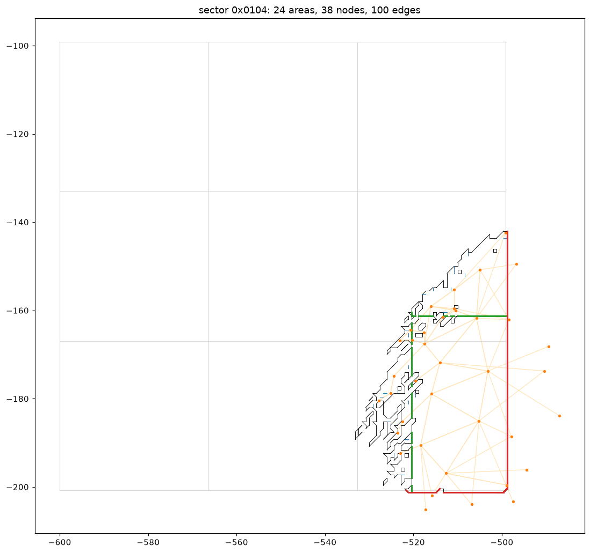

# Kynapse navigation data in Medal of Honor (2010) – specification (work in progress)

Interoperability specification written from reverse engineering (see `..\README.md` for the
clean-room rules). Sources: the user's own game files (`Output\win32\ai\levels\<level>\{infantry,
vehicle}\pathdata.hpd`, 25 campaign files; byte-identical on Xbox 360), Napisal's MP files, and the
behaviour of the generator code in mohmpgame.exe build 795745 (Project OPFOR
`research\MOH_DECOMP_RESEARCH.md` §9), observed only at its boundary with DICE's engine code, plus
in-game collision samples taken through the engine's own physics queries. Status 2026-10-14: file
format complete (§4, byte-exact rewrite); builder stages described (§3.1–3.2); walkability rules
measured against DICE's data (§3.3–3.7 – the sections record the investigation in order, §3.7 holds
the current rules and results); mesh/graph generation rules (outlines, areas, portals, graph) still
to be implemented and checked. **Status 2026-10-26:** the generator (`tools\navbuild.py`) implements the rules
recorded here on all 15 levels with DICE path data (parity in `..\README.md`); D lines and F cells (§4.5) and the
vehicle file (§2.2) are generated; what the runtime needs from the file is in §4.5. The sections keep the order
in which things were found.

## 1. Where the data is used

- Runtime: the level's `PathfindingTypes` (`AI/Pathfinding/Infantry`, `…/Vehicles`) select the
  data; the runtime world (Kynapse mode "Minimal") loads `…/<OutputName>/PathData.hpd`
  (`OutputName` from `PathfindingType`: "Infantry", "Vehicle"). Sector origin per level:
  `Levels/<lvl>/Precomputed/{Infantry,vehicle}/SectorOffsets.dbx` (`XOffset`, `ZOffset`).
- Coordinates: game world space, Y up (e.g. SP_009 spawns at y ≈ 480–585).

## 2. Build settings (inputs)

Shipped as `PathfindingSettings` / `PathfindingZoneSettings` / `PathfindingType` (values in
`MOH_DECOMP_RESEARCH.md` §9). Infantry: StepMax 0.28, StepLength 0.36, HoleMax 0.28, slope 40°,
Pitch 0.8, GraphAccuracy 3, NbSectors 32, EdgeRadius 0.41, EntityHeight 1.9, entity radius 0.4,
swept-sphere collision, detailed zones at Pitch 0.2. Vehicle: StepMax 0.4, HoleMax 0.75, slope
25–40°, Pitch 1, GraphAccuracy 15, NbSectors 64, EdgeRadius 2.51, EntityHeight 4, radius 2.5,
cylinder collision.

### 2.1 Vehicle path data (research 2026-10-23)

- **Two pathfinding types only.** `AI/Pathfinding/{Infantry, Vehicles}` (`PathfindingSettings`) with
  `{InfantryData, VehicleData}` (`PathfindingType`: `OutputName` Infantry / Vehicle). The engine knows two
  generators, `PgFrostbiteMapBuilder` (infantry) and `PgVehicleMapBuilder` (vehicles), and three collision models
  (`PCMSweptSphere` infantry, `PCMCylinder` vehicles, `PCMSphere` unused). **There is no air or water type:** MOH's
  navigation data is ground only. Water is excluded (`ForbidWater` true; `WaterLevelAdjustment` -1.6 for vehicles,
  -3.5 infantry). AI aircraft and boats have no navigation data: in the campaign they are player-driven or scripted
  set pieces; the levels' waypoint paths (`AnimatedWaypointData` / `WaypointData`, 10-37 per campaign level, none on
  the Onslaught maps) are squad and patrol routes for soldiers (one tank patrol on sp_008), used by
  `AreaGeometryEntityData` orders. `HelicopterControlConstantData` and `BoatFloatPhysicsData` are vehicle physics.
- **Vehicle settings that differ from infantry** (compared with `mp_common`'s Infantry, whose Pitch 0.2 /
  GraphAccuracy 0.5 / NbSectors 128 differ from the campaign values above): Pitch 1 (no detailed zones), StepMax /
  StepLength 0.4, HoleMax 0.75, GroundSlopeMin / Max 25 / 40, EntityHeight 4, EdgeRadius 2.51, ForbidHeight 5,
  GraphAccuracy 15 (infantry 0.5),
  NbSectors 64, VerticalPitch 2, MaxPitch 2, `UseExclusions` true (infantry false), `InfantrySeeds` false /
  `VehicleSeeds` true, `BuildRoads` true, `BuildBridges` false; type data: EntityRadius 2.5, DistEdgeMax 50,
  `CanGoMaxEntityRadius` 2.5 (infantry 1000), `UseLocalPathfinding` false (infantry true), `AccidentDetection`
  `PadVehicle` (the enum also has `PadPredictMove`, `PadTaken`), MaxGraphHandles 128, SubgraphsToLoad 3,
  DiagramHalfWidth 20.
- **Coverage:** every level with DICE data has a vehicle file except sp_009. It covers far less than the infantry file:
  sectors 5-78 against 27-380 (sp_03 14 / 304, sp_006 78 / 380, ons_mp_002 19 / 56), route nodes 58-3,802 against
  959-76,879 - consistent with `VehicleSeeds`: the build floods only from vehicle spawn points
  (`VehicleSpawnEntityData`, 2-65 per level), so it holds the drivable ground connected to where vehicles start.
- **Roads:** `BuildRoads` and the levels' terrain splines (`TerrainSplineData`, 1-42 per level) - much of the vehicle
  ground lies well away from spline control points (sp_04: 39 % of vehicle cells within 15 m of one; ons_mp_004 66 %),
  so the data is general drivable ground, not a road graph; how roads are marked in it (a record field, costs) is open.
- **For a generator:** a second sampling run with the vehicle cylinder (radius 2.5, height 4), seeds from vehicle
  spawns, the vehicle step / slope / hole limits, water depth 1.6 m, exclusions, pitch 1 and GraphAccuracy 15, route
  edges to 50 m. Air and sea vehicles need navigation OPFOR builds itself (no Kynapse data exists for them).
- **AI boats without navigation data (Napisal's ons_mp_004, research 2026-10-24).** Isla Inocentes is the only
  Onslaught port with AI-driven boats: two Team2 `VehicleSpawnEntityData` `Spawn_Pbl` (patrol boat, at (45, 77, -319)
  and (-8, 76, -2)), linked both ways to four `SSAiPlayer` spawners `Stranded Ship_SS03` (driver seat 0, gunner seat 1,
  through the spawner's `Vehicle` array). The same set-up seats AI in T-90s and Mi-24 / Mi-28 helicopters; ons_mp_002
  has none. No order entity is connected to the boat spawners (only the delay trigger that enables them). The level's
  vehicle file (`vehicle\pathdata.hpd`, DICE's console data) stays on land: water surface y 76.1, lowest vehicle area
  76.6, lowest vehicle route node 78.9 (infantry file: areas down to 74.7, wading depth). So the boats run on the
  vehicle AI's generic behaviour with no routes. Whether they travel anywhere, and which pathfinding type the vehicle
  driver asks for in a boat, is open: a run-time probe (position, speed, route requests of the AI boats) and a short
  targeted look at the driver's route request answer it. Approach for a water mesh: OPFOR's `STOCK_MP_AI_PLAN.md`
  section 11.

### 2.2 Vehicle path data measured, and NavKit's vehicle generator (2026-10-26)

Measured on DICE's 16 vehicle files (13 campaign levels - all but sp_009 - and the console Onslaught files of
ONS_MP_002 / 004 / 005gr / 008), against NavKit's in-game samples (14 levels), the terrain height fields and the
level XML. "Inferred" marks what the data fits but does not prove.

- **One file per pathfinding type, same format.** The vehicle data is its own `vehicle\pathdata.hpd`, not a layer
  of the infantry file: header, sector table, route graph and runtime mesh exactly as section 4 (every vehicle file
  round-trips byte for byte; `hpdcheck` passes on all of them). Per sector: pitch 1.0, resolution 0.02, entity
  radius 2.5, 3 x 3 tiles, DistEdgeMax 50 on the first node; build dates per file (campaign January 2010, Onslaught
  March - April 2010). Its sector offsets are its own (the most common floor(centre / 100) - grid id; 7 of 13 shipped
  `Precomputed/Vehicle/SectorOffsets` differ from the "one below the extent" rule, 3.9).
- **Grid and tiles.** Outline vertices at (k + 0.5) m (99 % of coordinates; the rest are 45-degree bridge points);
  tile lines 48.5 and 98.5 m into the sector - tiles of **50 samples** as infantry's (40 m at 0.8, 50 m at 1.0), the
  third tile only 3 samples wide (98.5 .. 101.5). Rect -1.0 .. 101.1, edge sectors from 0.0, at the grid maximum
  100.0 (as infantry, 4.5). Portals off the tile lines exist but there is no fixed 25 m cut line.
- **Heights.** Route nodes at ground + **2.0 m** (EntityHeight / 2; median 1.98-1.99 m over the terrain on four
  levels); area range lowest ground .. highest ground + **3.2 m** (0.8 x EntityHeight; infantry 1.52 = 0.8 x 1.9).
  Outline vertex heights scatter more (median terrain + 1.65-1.78 on slopes) - not a cell-centre height.
- **Areas are many and small.** Median area height span 0, 4-5 areas per tile (sp_006: 3,269 areas in 78 sectors);
  area boundaries away from tile lines have small steps (median 0.14 m) and lean to steeper ground, but no slope or
  step threshold separates them (open).
- **Vehicle ground lies on infantry ground** (98.8-99.7 % of its cells; sp_04, sp_006, ONS_MP_002), mostly 3 m or
  more inside the infantry outline where that outline is an obstacle - not where it is a steep slope: the vehicle
  ground runs right up to steep banks (no erosion by the radius at slope edges - inferred from maps of sp_04 / sp_01).
- **Slope:** by the surface normal, vehicle ground stops at about **25-28 degrees** (sp_04 open ground, share that is
  vehicle ground: 20-22.5 deg 73 %, 22.5-25 58 %, 25-27.5 29 %, 27.5-30 8 %, over 30 under 1 %) - GroundSlopeMin 25.
- **Clearance (inferred):** objects rising more than StepMax (0.4 m) above the local ground plane within the radius
  (2.5 m) remove ground; the terrain's own curvature does not - with terrain counted from 0.4 m, 9-18 % of DICE's
  ground failed the test (banks of sunken roads, valley floors). NavKit counts terrain only from a 0.8 m rise
  (sp_01: ground 86.4 -> 94.6 %, sp_04 84.9 -> 92.0 %, for +7 / +12 points of extra ground). ExcludeFromPathfinding
  objects are crushed (DICE: `UseExclusions` true for vehicles only).
- **Seeds: vehicle spawns and roads (measured).** Of the sectors with vehicle ground in DICE's files nearly all hold
  a terrain-spline control point (`TerrainSplineData` - DICE's `BuildRoads`) or a vehicle spawn; the sectors without
  ground mostly hold neither (sectors with ground holding a spline control point or a spawn: sp_04 63 of 65, sp_01
  30 of 33, sp_006 75 of 77; empty sectors holding neither: sp_04 4 of 7 - the other 3 hold control points -, sp_01
  2 of 2, sp_006 1 of 2). Land-vehicle spawns alone reach only 22-99 % of DICE's ground (sp_007 37 %, ONS_MP_004
  22 %); sector perimeter auto-seeds (infantry's rule, 3.5) reach 92-99.9 % but flood far more than DICE has
  (+92 % extra on sp_01). Fixed weapons and aircraft spawns add little.
- **Sectors without a seed stay empty (measured).** DICE's file lists sectors with no ground (sp_04 0x0a09: 0 areas,
  `Sectors without a seed are written empty`), and the ground of the sector next to it stops at the shared line over
  smooth terrain. The flood does not continue into a sector that has no seed of its own - per-sector seeding (sp_04
  extra ground 72 -> 26 %, sp_01 24 -> 21 % against one level-wide flood, same seeds).
- **Which sectors:** DICE built vehicle data in a chosen set of sectors (corridors along the missions' drive routes on
  campaign levels; sp_04 72 of 380 infantry sectors). No sector list, zone or bounds entity is in the shipped level
  data (`SectorsDefinitionFile` is a generator input). NavKit clips to the reference file's sectors for parity; a
  new map gets every sector its seeds reach.
- **Water:** no DICE vehicle ground more than 1.6 m (WaterLevelAdjustment) under the level's water on the levels
  measured (ONS_MP_002, sp_01, sp_02, sp_005, sp_007: 0 cells).
- **Open:** DICE's area division; the route-graph layout (DICE's sectors join through many more border links); which
  splines are roads (some splines shape terrain or rivers: NavKit seeds sectors DICE left empty, e.g. sp_01
  (200, -560)); ground DICE keeps that neither spawns nor splines reach (sp_007 20 %, sp_03).

NavKit's generator (`tools\navvehicle.py`, README "Vehicle path data") implements these rules; parity per level
there.

## 3. Build pipeline – behaviour of the original generator

Behavioural description for a re-implementation. Sources: the stage names, settings and engine
callbacks seen in mohmpgame.exe (Project OPFOR `research\MOH_DECOMP_RESEARCH.md` §9), the partial
run of the original tool on SP_009 (stages 1–2 completed), and rules measured on the output (all
campaign files; "measured" = verified statistically, "inferred" = consistent with the data but not
proven).

### 3.1 Inputs

- **The loaded level's collision world.** The tool never reads source assets; it asks the running
  engine's physics world (Havok) through five callbacks:
  - point query – is a position inside geometry / where is the ground (`FUN_00EFE7F0`),
  - ray cast from a point along a direction for a length – hit position and normal (`FUN_00EFE840`;
    used for ground height and obstacle edges),
  - capsule query with the entity radius and height – does a standing agent fit here
    (`FUN_00EFE920`, collision model `PCMSweptSphere` for infantry),
  - box query – the alternative volume test (`FUN_00EFE980`, used with `UseBoxApproximation`),
  - exclusion / forbidden-volume predicates supplied by the level (`ForbidPathfinding`,
    `ExcludeFromPathfinding`, water below `WaterLevelAdjustment`, `ForbidHeight`).
- **Settings** per pathfinding type (`AI/Pathfinding/Infantry`, `…/Vehicles`): pitch, step and hole
  limits, slopes, entity radius and height, edge radius, graph accuracy, number of sectors, detailed
  zones (finer pitch), `DistEdgeMax`.
- **Seed points** (walkable start positions, plus automatic seeding).

### 3.2 Stages

| # | Stage (original name) | Behaviour | Output |
|---|---|---|---|
| 1 | Dividing sectors | Split the level's bounds into a grid of **100 m sectors**, id = `0xXXYY` (grid x, y). Each sector covers 100 m plus a margin: one pitch on the near side and 1.1 × pitch on the far side (101.68 m for infantry); sectors at the level edge drop the near margin (measured). Detailed zones (`DetailedZoneSettings`) get their own pitch (0.2) and 6 × 6 tiles. | `Sectors.xml` |
| 2 | Generating seeds | Collect seed points (given + automatic: `AutoSeedStep` probes the ground with point queries). Sectors without a seed are written empty ("No seed found, write empty pathdata"). | `sector_<n>.autoseed` |
| 3 | Generating maps (per sector) | Sample the ground on a **regular grid with spacing = pitch at whole multiples of the pitch in world space** (the rectangle's minX = sector edge − pitch is one) – outlines then run **halfway between samples**, at (k + 0.5)·pitch (measured: every outline vertex; a re-rasterisation of DICE's areas at these sample points reproduces them 100 %). A cell is walkable when the ground is found, the slope is within `GroundSlopeMin/Max`, a capsule of the entity radius and height fits, and it is not forbidden/excluded/water (inferred from settings and callbacks). Flood-fill from the seeds over neighbouring cells whose height difference is within `StepMax` (inferred), so unreachable ground is dropped. Measured rules: §3.7. | `.aim`, `.udg` (grid maps) |
| 4 | Linking meshes | Trace the **outlines** of walkable regions halfway between samples (stair-stepped contours, holes for obstacles – measured). Split each sector into **tiles** (3 × 3; 6 × 6 in detailed zones) and sometimes cut regions further on a fixed grid **every 25 cells** (lines at minX + (25k + 24.5)·pitch: 20 m for infantry, 25 m vehicle, 5 m detailed – measured; infantry: only part of the ground is cut, see 4.5), giving **areas**. Shared cut segments become **portals** (B) to the neighbouring area; segments on the sector border become **border portals** (C) with an outward direction, listed per neighbouring sector/tile/area in the link table. Sides between two cells of one area that are not linked (height step over the link step) become **D lines**, and cells with both sides along an axis so broken become **F cells**, instead of outline (measured, 4.5 "D lines and F cells - the generator rule"). | `.pdl`, `.fdl` |
| 5 | Linking graphs | Build the high-level **graph**: nodes mostly within ~1 m of outline corners (obstacle corners offset by roughly the entity radius – measured: ~75 % infantry / ~60 % vehicle nodes), plus nodes in open ground; edges between mutually reachable nodes up to about `DistEdgeMax` (median 6 m; 99 % < 17.6 m infantry, < 48 m vehicle – measured), cost = floor(3-D length × 16). Nodes on sector borders are shared with the neighbouring sector (same id and position, high bit). | `.fsg` |
| 6 | Building hierarchical database | Assemble per-sector blocks (graph + runtime mesh), sort the node lookup lists by x, y, z, write the sector table with build timestamps. | `pathdata.hpd` |

### 3.3 Walkability measured against the engine (NavKit sampling, sp_01)

OPFOR's `[dev] navsample` option sampled a 200 × 200 m block of sp_01 (sectors 0x908–0xA09, 63,001
samples at 0.8 m) through the engine's own ray cast and capsule queries; `tools\navsample.py`
compared the result with DICE's `pathdata.hpd` (39,379 walkable reference cells):

- **Slope rule:** walkable when the hit surface's normal is within `GroundSlopeMax` (40°) of vertical.
  DICE's walkable share drops sharply at exactly that angle (78 % at 35–40°, 22 % at 40–45°);
  neighbour height differences or smoothed normals match worse. The sphere-cast radius (0.05 or
  0.001) makes no difference.
- **Geometry is complete:** flat samples two or more samples away from a non-walkable one match
  97–100 %, so the engine queries see all collision relevant to the original.
- **Residual:** with normal ≤ 40° and the soldier capsule (r 0.4 from StepMax 0.28 to 1.9 m), 90.7 % of
  the reference is found and 17.3 % extra is marked. Practically all disagreement lies within one
  sample of a walkable edge – the original decides edge cells by a finer rule not identified yet.
- A ray cast that starts inside geometry (under terrain, inside a slab) reports an immediate hit;
  the sampler steps down through solid geometry (0.5 m steps, up to 10 m) to find lower storeys.

### 3.4 Edge rule and region filter (fine 0.2 m sampling of the same block)

(Single-layer measure on the mountain block; superseded by the multi-layer rules and results in §3.7.)

- **Outline geometry:** outline vertices lie on cell corners ((k + 0.5)·pitch in both axes); segments are
  axis-aligned or exactly 45°. A 45° segment passes through a sample and cuts its cell in half, so
  comparisons count such cells separately ("cut cells", ~18 % of the reference here).
- **Outline height:** outline y ≈ ground + 0.95 m (half `EntityHeight`), ±0.4 m; the exact ground
  point it is taken from is not identified yet.
- **Slope:** the slope from heights 0.2 m either side of the sample (central difference) against 40°
  matches best (found 95.4 %, extra 11.8 %); the surface normal is a close second; footprint
  (agent-disc) and majority rules are worse.
- **Regions:** most remaining extra cells are whole regions DICE does not keep. Keeping only regions
  that DICE also has gives 99.9 % agreement within one cell – so the missing rule is which regions the
  original keeps. DICE has 320 separate walkable regions in this block, many unreachable from any
  spawn, so seeding is not spawn-based: it comes from the "Generating seeds" stage (DICE's
  `FrostbiteAutoSeedStep`). Seeding from five spawn-like points with a step of 0.9 m (8-connected)
  gives 97.4 % within one cell, 11.7 % cell-exact error.

### 3.5 Auto-seeding observed (sp_01, 2026-10-14)

Observed at the boundary only (OPFOR `[dev] navgen` with `navgen_capture=1`: DICE's point-query
callback of `FrostbiteAutoSeedStep` and DICE's file callbacks; the run stops at the licence check as
before). Stage 2 ran on two sectors (257, 513 – built around the single given seed):

- **Where:** only on each sector's **perimeter lines, two samples (1.6 m) in from the sector edges**
  (x = minX + 1.6 / maxX − 1.6 for every z, and z = minZ + 1.6 / maxZ − 1.6 for every x; 972
  columns for two sectors), at the pitch spacing (0.8 m).
- **How:** each column is swept from the top of the sector box (UpMax 426.75 + 0.95) to the bottom in
  **0.4 m steps** with a **sphere of radius 0.4** (EntityRadius); result = geometry within the
  sphere. Free→blocked transitions mark surfaces (2–4 per column on sp_01: terrain and overhangs).
- **Output:** `sector_<n>.autoseed` stayed empty in this run (the stage reports "Generating seeds
  done"), so which transitions become seeds is not observed yet.
- **Effect on regions:** keeping only walkable regions that touch a perimeter line gives 97.5 % agreement
  within one cell (8-connected, step ≤ 0.9 m) – the same as spawn-style seeding; the remaining gap is
  the connectivity rule between samples (too lenient joins regions DICE keeps apart, too strict loses
  regions DICE keeps, probably via the level's own seed entities).

### 3.6 Seeds and forbidden objects (sp_01 level data, 2026-10-14)

- The level file (`levels/SP_01.dbx`) has **no explicit seed list**; `InfantrySeeds`/`VehicleSeeds` are
  settings flags. sp_01 has 341 spawn entities (soldier, ghost, alternate, vehicle), none in the
  test block – the block's walkable regions are seeded from sector perimeters only.
- Object blueprints carry pathfinding flags: `ExcludeFromPathfinding`, `ForbidPathfinding`,
  `AllowPathdataSeeds`, `LocalPathfinding`, `DisablePathfinding`. On sp_01 `ForbidPathfinding` is set
  on rocks, boulders, cliffs, stone formations, palm trees, `Tree_XXXL`, trench camo, wreck parts,
  barrels (27 blueprints, 350 individually placed instances); `ExcludeFromPathfinding` on palm trees
  and weak fences. Many props are placed through static-model groups whose instance transforms live
  in the binary Havok assets.
- Every downward ray in the test block hit the same body type (DICE's ray collector, vtable
  0x014573D8, keeps the two root collidables at +0x50/+0x54) – no object tops are involved there.
- The far extra regions (walkable for NavKit, absent in DICE's data) are plain terrain; 34 % have a
  capsule-blocked sample (a trunk) within 4 m versus 11 % of correctly kept cells. Likely cause:
  forbid footprints of vegetation (trees, undergrowth) applied by the original build but invisible
  or only partly visible to the AI's physics queries. Next: read vegetation placements from the
  level's Havok assets and apply forbid footprints.

### 3.7 Walkability rules that reproduce DICE's data (sp_01, 2026-10-14)

Implemented in `tools/navwalk.py` (object data from `tools/levelobjects.py`, Havok
assets read with `tools/hkpack.py`):

1. Candidate: soldier capsule fits and surface normal within 40° (GroundSlopeMax).
2. **Forbidden objects:** surfaces lying on the collision triangles (within 0.08 m) of placed objects
   whose blueprint has `ForbidPathfinding` are removed (rocks, cliffs, boulders, big trees …).
   Footprint hulls are too coarse (they remove ground DICE keeps between rocks).
   The tolerance is 0.08 m: the sampled height is the hit surface itself, so a surface on the
   object lies within a few cm of its triangles. 0.2 m marked stair treads touched by decorative
   rocks / palms / invisible walls as rock (sp_01 hilltop stair route 1/17 positions -> 15/17;
   order coverage 577 -> 590 of DICE's 633; 0.04-0.06 m loses again, 0.12 m is close).
3. **Connectivity:** 8-connected; height step relative to the local ground plane (from both normals)
   at most StepMax 0.28 m (0.4 m fits the steep mountain block slightly better). This rule decides what is
   reachable (seeding), portals and routes; how ground divides into areas follows the stricter raw 0.6 m step
   on terrain (§4.5).
4. **Seeds:** sector perimeter lines (1.6 m inside each 100 m sector edge), **terrain only** – objects
   have `AllowPathdataSeeds` false by default, so roofs crossing a perimeter line are not seeded.
5. Outline heights in `pathdata.hpd` are ground + 0.95 m (EntityHeight / 2); compare with that offset.

Object data: individually placed objects are `Entity.ReferenceObjectData` (blueprint + matrix);
grouped objects, forest and middle-growth are `Physics.CompositeHavokAsset` (`Assets[i]` +
`Transforms[i]`, 4×4 row-major, translation in the last row); collision of a blueprint is its
`<name>_Havok.res` (Havok 5.5.0 packfile after a DICE header; storage extended mesh subparts:
vertices at +0x08, 16-bit indices at +0x14 in groups of four).

Results (multi-layer, cells fully inside DICE areas, height tolerance 0.6 m):

| Block | Found | Extra (far) | Within 0.8 m |
|---|---|---|---|
| Base area x −600…−400, z −500…−300 (78 spawns, buildings) | 99.5 % | 2.7 % (1.9 %) | **97.9 %** |
| Mountain x −100…100, z 100…300 (step 0.4) | 92.0 % (98.8 % within 0.8 m) | 6.7 % (3.3 %) | **95.7 %** |

Residual: mostly bare terrain at the slope limit, where DICE's and NavKit's decisions are both speckled
by small bumps (the walkable set flips cell by cell around 40°), plus a few building tops.

### 3.8 Structures, doors and connectivity (sp_01, 2026-10-15)

- **Seeds on objects too:** terrain-only perimeter seeding dropped decks, platforms and floors (AI order
  coverage 452 → 596 of DICE's 633).
- **Border nodes on every layer:** a floor under a roof must get its own border nodes on the sector lines.
- **Dynamic objects** (`DynamicModelEntityData`: crates, pallets, barrels) and objects with
  `DisablePathfinding = PdtWhenAlive` (doors – the sub-pen stairwell door) are absent for path data.
- **Barrier arms:** a forbidden object whose whole collision is one thin raised bar (≥ 0.7 m above its
  origin, ≤ 0.5 m thick, ≥ 2 m long – the checkpoint pole) is passable; DICE's routes cross closed gates.
- **Stairs:** on objects, slope from neighbour heights (one-sided on narrow stairs), clearance from a second
  sample run with the capsule from 0.6 m, also on landings.
- `ExcludeFromPathfinding` (fences, sandbags, palm trees): making them passable over-connects; not applied.
- **DICE's route network is not complete connectivity:** two of its groups come within 1.9 m on flat open
  ground (-309, 99, -415) with no edge. Comparisons against DICE's route groups (`ordercheck.py` pairwise /
  self-check) therefore measure network layout, not walkability; the runtime bridges such gaps.

### 3.9 Areas are single-layer; more levels (2026-10-15)

- **An area never holds two surfaces of the same column.** The 8-connected flood fill of a tile can
  reach a second floor round a corner (floor and bed / table top / mezzanine 0.5 m apart, joined through
  a stair or ramp elsewhere in the tile). Such an area overlaps itself in plan, so a point-in-area test
  (the runtime's and `ordercheck.py`'s) fails on whole rows of it. Rule: a surface whose column the area
  already holds starts its own area (joined by portals). Before the fix 18 % of NavKit's sp_01 areas had
  stacked outline segments against 0.3 % of DICE's; after it, sp_01 order coverage rose 590 -> 607 of
  633 and the pairwise route check 82.4 % -> 89.1 %.
- **Forbidden-object tolerance 0.08 m** (§3.7 item 2).
- **Outline sides:** a side of an area cell is interior when *any* connected surface across it belongs to the
  area (a column can hold two connected surfaces - a stair edge, or a cell split off by the single-layer
  rule); taking only the nearest one left stray portals inside areas.
- **45° bridges** only across an open corner (neither cell has a connected surface beside it there - else
  those sides are portals). Where the inner edges of two bridges cross (one cell with diagonal-only
  neighbours on both sides of an empty cell) the outline is the boundary of their union: split at the
  crossing, drop the pieces inside the other strip. Self-check (every cell inside its own outline):
  sp_004_b 1,851 failing cells -> 323, the rest zero-width cracks (next item).
- **Cracks:** two adjacent cells of one area that are not connected to each other (a step), both joined
  to the area elsewhere, give two coincident outline segments. DICE's files contain these too (458 of
  2,381 areas on sp_004_b with a repeated segment); an inside test cancels coincident pairs.
- **Objects without their own collision** (`InvWall_SP03`) use the collision of their `Mesh` reference's
  blueprint (`InvWall`). Missing it left a scripted invisible wall with `DisablePathfinding = PdtWhenAlive`
  blocking routes; DICE's data passes it (sp_003_b main network 490 -> 680 positions, DICE 712).
- **Collision packfiles named `<name>_Havok_Havok.res`** (sp_009's `plane_floor2_door_animate`, `inv_Wall`) belong to
  blueprint `<name>`. Missed, the aircraft's `PdtWhenAlive` doors stayed solid and cut its cabins apart; DICE's data
  walks through them (2026-10-22). A narrower capsule (0.3 / 0.25 / 0.2 m, sampled in game) did not open the doorways
  and widened the aisles past DICE's 0.8 m: DICE's clearance is the same 0.4 m radius - the doors are simply absent.
- **Dynamic props at pitch 0.2:** a prop lying on the floor hides it (the rays record only the prop - a gate's bottom
  rail 0.09 m up), and a thin vertical leaf on a sample row is hit on its faces 0.8-1.5 m up with no triangle under
  the hit; both are the prop, not floor or ceiling (sp_003_b's monastery gate, sp_009's aircraft doors).
- **DICE's slope test is the normal's, at 40 deg, on terrain and objects alike** (sp_007 / sp_003_b at pitch 0.2:
  DICE covers 81-100 % of terrain under 40 deg, 10-33 % at 40-45, under 4 % above; rock meshes in sp_003_b's gully
  about 0 %). Narrow steep bands (lips, sills) between walkable ground are crossed: at 0.8 m by the step rule, at
  0.2 m NavKit accepts bands of up to two samples (`LIP_WIDTH`, `LIP_OBJECT_RISE`).
- **Stale reference data:** DICE's sp_03 links a valley to a plateau only through 93 nodes 1.5-5 m under the PC
  ground (cliff mesh `sp03_cliff_2` and raised terrain); elsewhere 99.8 % of its nodes are on PC ground. Parity
  measures leave such nodes out (`navparity.stale_nodes`).
- **Small islands:** DICE keeps unreached islands at ground level but not detached roofs and scenery tops (all 15
  levels: dropping unanchored islands under 25 nodes cost as much DICE ground as extra it removed; dropping unreached
  roof islands without reached ground beside them cost 0.28 points for 1.31). Combat areas do not bound DICE's data
  (61-95 % of its ground lies outside them on most campaign levels).
- **Every area boundary is closed** in DICE's files: an area's outline (E), portals (B) and border portals (C), as
  segments, meet in pairs at every end point (0 open areas on sp_01 and sp_004_b). Cracks are coincident pairs;
  45-degree bridges between diagonal-only cells end where the cell edges they replace began. NavKit's clipping of
  overlapping bridges left open ends in 1.7-3.1 % of areas (2026-10-23; `navbuild.BRIDGE_UNION`: the exact union of
  the half-cells the bridges cover).
- **Objective targets on forbidden objects:** the M-COM (`mpobjective`) blueprint sets `ForbidPathfinding`; its top
  is not floor, and the ground under it is inside its collision (no room for the soldier) - DICE's campaign files
  have no ground at the origin of any of their 24. Napisal's Onslaught AI orders aim at M-COM origins (0.0-0.1 m),
  and DICE's console path data has ground there (its layout had no object at those spots): with NavKit's PC file 14
  of 15 such orders are on no area, and the game's destination query fails. No campaign order sits on an M-COM.
  NavKit's objective floor rule (2026-10-24, `navwalk.OBJECTIVE_FLOOR`) keeps the floor under and around an
  `AreaOrder` position on a forbidden object: in the samples the floor under an M-COM lies on a forbidden triangle
  itself (its collision's bottom face), with the top 0.6-0.8 m above. Result: 13 of 14 targets on an area (DICE 14).
  The floor is the sampled layer nearest the target's height among 0.1 m height bins holding at least 2 hits and a
  quarter of the fullest bin's (2026-10-24): a median over all candidate surfaces took the terrain under a slab
  (ONS_MP_002 "Arm A3": the M-COM on a slab 0.9 m above the terrain), and "nearest" alone took stray hits on an
  M-COM's sides 0.2-0.6 m under a target on its top (ONS_MP_004). Result: all 14 targets on an area, AI coverage
  100 % on both maps.
- **`DisablePathfinding`** on placed objects (15 levels): `PdtNever` 32,854, `PdtWhenAlive` 729 (doors, gates, scripted
  walls; absent for path data), `PdtWhenDestroyed` 556 (houses, factories, wooden walkways, rope bridges),
  `PdtWhenPartDestroyed` 13, unset about 4,500. With the level settings `DestructibleLocalPathfindingParts`,
  `PathObjectCount` and `MaxLocalPathfindingObjects` this points to runtime handling of destruction: path data for the
  intact level, switched off on objects once destroyed (inferred - how the runtime finds an object's areas is not
  traced). Openings made by destruction are not routes.
- **Soldier spawn points seed the walkable surface.** DICE's data has closed upper floors (reached by
  ladders or scripted spawns, no walkable link) as isolated islands of 5-8 nodes; every one holds
  `SoldierSpawnEntityData` positions, and no seed entities or `AllowPathdataSeeds` objects are there.
  Seeding from the spawn points (the walkable surface 0-1.5 m below) - sp_004_b coverage 87.3 -> 93.4 %,
  sp_01 97.0 -> 97.6 %. (Seeding from all AI order positions instead over-covers.)
- **No lone nodes:** DICE's files have no node without an edge (0 of 24,743 on sp_01). Nodes with no edge in
  any sector (tiny islands, slivers on a sector line) are dropped (sp_004_b pairwise 76.9 -> 86.4 %).
- **Stair step rule:** where a stair surface meets a flat landing, the mean of the two gradients halves the
  predicted rise of the last step; the step also fits when it matches the stair surface's own incline
  (sp_006: a three-step stair into a building block, risers 0.2 / 0.37 / 0.23 m, split the route network -
  pairwise 59.5 -> 92.7 %).
- **Narrow passages** (sp_009 plane aisles, seats leave less than the 0.8 m capsule width): DICE's data
  connects them. The narrow-capsule rule (§3.8, 0.25 m run) now gains on sp_01 (coverage 97.6 -> 97.9 %,
  pairwise 89.5 -> 90.3 %) but connects ~19,300 more point pairs DICE does not (100,759 vs 81,425 only-ours
  pairs) - kept optional.
- **Open:** sp_008_b - NavKit keeps a 36° sloped bridge-foundation strip and a container / fence passage
  between harbour fences (`ForbidPathfinding`) and invisible walls that DICE leaves out; 3 of the 16 graph
  edges joining two DICE groups lie entirely on DICE's areas (gaps in DICE's network), the rest cross these
  two spots.
- **Ladders are not in the path data:** islands reached only by ladder stay islands; bots spawned there
  move on that floor only.
- **Per-level inputs:** `SectorOffsets` (`Levels/<lvl>/Precomputed/Infantry/SectorOffsets.dbx`) gives the
  sector grid. Levels without one (the Onslaught ports, stock MP levels, new maps): offset = floor(lowest
  path-data extent / 100) - 1 per axis, so the first sector id is 1,1 - every shipped infantry SectorOffsets
  follows it (13 campaign levels and DICE's Xbox ons_mp_005 / ons_mp_008), and so does DICE's ons_mp_002 /
  ons_mp_004 infantry path data (-3,-7 / -3,-5); a new map without path data uses its sampling box's minimum.
  Correction (2026-10-21): 7 of the 13 shipped vehicle assets do not follow it (vehicle data starts further in
  than the grid DICE numbered it on; ONS_MP_002's vehicle file: rule -2,-7, asset and ids -3,-7). The offset a file
  was built with is read from its own sector ids: per sector floor(centre / 100) - grid id, the most common value -
  27 of 27 shipped assets. OPFOR's apply_sector_offsets.py writes the PC ports' assets that way. Whether the runtime needs the
  ids to match an offset is unproven. The sampling box is DICE's sector bounds plus a margin (for levels without data: the
  playable area). Two sampling runs per level: the normal capsule and the high capsule (from 0.6 m) for
  stairs and landings.

The original tool's map-building step (stage 3) is licence-protected (section 5); NavKit implements
these stages independently.

## 4. `pathdata.hpd`

All values little-endian. **Verified** by `tools\hpdtool.py roundtrip`: all 74 `.hpd` files of the
base game and Napisal's install are parsed and written back byte for byte (2026-10-14).

### 4.1 File layout

| Offset | Size | Content |
|---|---|---|
| 0x00 | 12 | `"Kynogon HPD\0"` |
| 0x0C | 36 × u32 | header words: `2, 2, <sector count>, 1, 0,0,0,0, 2, 0, 8, 0 … 0, 36, 12, 1, 0` – identical in every file except the count |
| 0x9C | count × 48 | sector table |
| 0x9C + count×48 | Σ sizes | sector blocks, contiguous, in table order; they end exactly at the end of the file |

### 4.2 Sector table entry (48 bytes: `<I6f5I`)

| Field | Meaning |
|---|---|
| u32 id | sector grid coordinates `0xXXYY` (0x0101, 0x0102, 0x0201 … = decimal 257, 258, 513 – the original generator's `sector_<n>` file names) |
| 6 × f32 | bounds **minX, maxX, minY, maxY, minZ, maxZ** (world space, Y up) |
| u32 | 0 in every file |
| u32 size | block size in bytes |
| u32 offset | block offset from the start of the block area (running sum of the previous sizes) |
| u32 date | build date `YYMMDD` with **zero-based month**: campaign files `100007`–`100012` = January 2010; Napisal's Onslaught files `100330`/`100404`/`100407` = April–May 2010 (built by DICE before the June 2010 Onslaught release) |
| u32 time | build time `HHMMSScc` (e.g. `13305600` = 13:30:56.00) |

### 4.3 Sector block

| Part | Layout |
|---|---|
| counts | u32 node count, u32 edge count |
| nodes | node count × 36 bytes `<I3fIf3I>` – see 4.3.1 |
| edges | edge count × 12 bytes `<3I>`: cost, source node index, target node index – see 4.3.1 |
| runtime mesh | the rest of the block, starting with `"KynogonRuntimeMesh"` |

Sizes: SP_005 infantry has 269 sectors, 69 095 nodes, 199 572 edges and 18.4 MB of runtime mesh.

#### 4.3.1 High-level graph (verified statistically over all 2 776 campaign sectors)

| Node field | Meaning | Evidence |
|---|---|---|
| u32 id | node id, unique per sector; **high bit = border node shared with a neighbouring sector** | every high-bit node's id appears in a neighbouring sector at exactly the same position (84 688 / 84 688) |
| 3 × f32 | world position | inside the sector bounds |
| u32 flags | always `0x80000000` | 537 707 / 537 707 |
| f32 value | **DistEdgeMax** on the first node of each sector (infantry 15, vehicle 50 – the `PathfindingType` value), 0 elsewhere | 534 931 zeros, 2 391 × 15, 385 × 50 |
| u32 a | index of the node's first outgoing edge **+ 1**; **0 when the node has no outgoing edges** (5 449 nodes in sp_01, mostly border nodes whose edges are stored in the neighbouring sector) – a non-zero value there makes the runtime read another node's edges (crash in game, 2026-10-15) | 2 776 / 2 776 sectors |
| u32 b | low u16: k-th entry of the node indices **sorted by x**; high u16: sorted by **y** (spatial lookup lists stored interleaved, one entry per node slot) | 93 % / 98.7 % exact, the rest are ties |
| u32 c | low u16: k-th entry of the node indices **sorted by z**; **bit 16 set on border nodes** | 92.8 % exact (ties); bit 16 on exactly the 30 351 border nodes of the sample |

Edges: **sorted by source node**; cost = `0x80000000 | floor(3-D distance × 16)` (1 521 636 of
1 521 644 edges exact; the rest differ by float rounding); pairs usually exist in both directions.
Open for exactness: the tie-break order of the three sorted lists.

### 4.4 Runtime mesh record – structure (complete)

**Verified:** `tools\hpdtool.py coverage` explains every byte of all 7 944 runtime meshes in the base
game and Napisal's files (no gaps, no overlaps). The record is a relocatable memory image: all
offsets are relative to the start of the record (the marker), and **-1 means null**. The game's
loader turns offsets into pointers in place (the relocation walk defines which fields are offsets).

**Header (0x50 bytes):**

| Off | Type | Content |
|---|---|---|
| 0x00 | char[20] | `"KynogonRuntimeMesh"` + 2 zero bytes |
| 0x14 | u16 | version 2 |
| 0x16 | u16 | flags (0 in files; the loader sets bit 0) |
| 0x18 | u32 | 0 in files (the loader stores the record address) |
| 0x1C | u32 | sector id |
| 0x20 | f32 | resolution: 0.02 vehicle, 0.025 infantry, 0.05 detailed zone |
| 0x24 | f32 | **Pitch** (1.0 vehicle, 0.8 infantry, 0.2 detailed zone) |
| 0x28 | 4 × f32 | sector grid cell **minX, maxX, minZ, maxZ** – cells are 100 m; the far sides extend by 1.1 × pitch, inner near sides start one pitch early (e.g. infantry 0x0102: z −0.8 … 100.88) |
| 0x38 | u32 | tiles across X (3; 6 in detailed zones) |
| 0x3C | u32 | tiles across Z (3; 6) |
| 0x40 | f32 | entity radius (2.5 vehicle, 0.4 infantry) |
| 0x44 | u32 | offset of the tile table (always 0x50) |
| 0x48 | u32 | number of neighbour-link entries |
| 0x4C | u32 | offset of the neighbour-link table (−1 if none) |

**Tile table** at 0x50: tilesX × tilesZ + 1 offsets. The last entry points at a 4-byte slot that the
loader never reads (DICE's tool left uninitialised memory there – keep for exact copies, write 0).

**Tile:** u32 item count n; if n > 0: n × {u32 object offset, f32, f32 (min/max height of the
object)} followed by u32 end offset (end of this tile's data). An empty tile is just the count.

**Mesh object** (referenced from tiles): 0x50-byte header – u32 sector id (renumbered by the loader
if the record's id changes), …, f32 entity radius (+0x10), f32 pitch (+0x14), f32 max height
(+0x18), f32 min height (+0x1C), then pairs {u32 count, u32 offset (relative to the object, −1 if
none)} at +0x20 (A), +0x28 (B), +0x30 (C), +0x38 (D), +0x40 (E), +0x48 (F). Data follows the
header contiguously:
- A: count × 0x20-byte records (offset field at +0x18)
- B: count × 0x20-byte records – two 3-D points (a segment) and an offset at +0x18
- C: count × 0x2C-byte records (offset field at +0x18)
- D, E: an index table of count + 1 u32 (offsets relative to the object) then variable-length data
  (E holds point lists – polylines)
- F: (count + 1) × 16-byte table then variable-length data
Semantics of A–F: in progress.

**Neighbour links:** table of 12-byte entries {u32 neighbour sector id, u32 count, u32 offset of a
list}; each list holds `count` offsets of link objects; a link object has u32 count at +0x0C followed
by that many u32 offsets at +0x10.

**Trailer:** the last 8 bytes are {u32 own offset, u32 0}.

### 4.5 Semantics (from statistics over all files and plots made with `tools\hpdview.py`)

- **Mesh object = one walkable area inside one tile.** Object header +0x04/+0x08 = the tile's
  x/z index in the sector (0–2, or 0–5 in detailed zones), +0x0C = 0 (possibly a layer index),
  +0x10 entity radius, +0x14 pitch, +0x18/+0x1C max/min height of the area.
- **A:** never used (count 0 in all 171 354 objects).
- **E: the area outline** – line segments (each list holds 2 points = 24 bytes in the samples) on the
  pitch grid, giving stair-stepped contours, including closed outlines of holes (obstacles). The
  original generator samples the ground on a regular grid with spacing = pitch and traces contours.
- **Areas are a decomposition of the walkable ground** into pieces of roughly 20 m (split along tile
  boundaries and further straight cut lines); black outlines in the plot enclose the non-walkable
  parts (obstacles), the open space is walkable.
- **How DICE divides a tile into areas (infantry, measured 2026-10-16 on sp_004_b, sp_005, sp_007, sp_009):**
  - Same-sector portals lie on the tile lines (38.8 / 78.8 m into the sector, plus 39.6 / 79.6 steps) and
    otherwise only on the fixed tile midlines (18.8 / 58.8 m): sp_005 17 %, sp_007 3 %, sp_004_b 2 % of
    portals. There is no cut at the middle of each area's extent.
  - The midline cut is not decided by size: whole 2,500-cell tiles stay uncut. Cut ground tends to have long
    outlines (sp_007: "cut when the summed outline exceeds 300 segments" is right for 99.1 % of ground spanning a
    midline, against 99.4 % for "never cut"; sp_005: 91.7 % against 94.1 %). The trigger is still unknown.
  - **Midline cut, measured again (2026-10-19, sp_004_b, sp_007, sp_005; unit = DICE areas joined only through
    portals on a midline, against single areas crossing a midline uncut):** the cut is **conditional**, not a
    fixed rule. It is on **one axis only** (0 of 326 cut groups are cut on both axes - halves, not quadrants) and
    along the **longer** side of the area's bounding box (325 of 326). No tested trigger separates cut from uncut
    on all three levels: height span (cut 6.6-35 m, uncut up to 42 m), cell count (cut halves median ~920 cells,
    uncut areas up to a whole 2,500-cell tile), boundary edges (outline + borders + outgoing portals; "cut when
    over 255" is right for 98.4 % on sp_004_b, 96.8 % on sp_007, 87.5 % on sp_005). sp_004_b has only 2 cut groups.
    Not implemented; parity-only work.
  - **Detailed zones - which sectors (2026-10-19, sp_004_b, sp_005, sp_007):** a sector is detailed entirely or not
    at all (0 of 108 detailed sectors also hold pitch-0.8 areas). Header of a detailed sector: pitch 0.2, resolution
    0.05, 6 x 6 tiles of 20 m (rect -0.2 .. 100.22); normal: pitch 0.8, resolution 0.025, 3 x 3 tiles of 40 m. The
    header has no tile-size field (how the runtime gets 20 m vs 40 m is not known). **Trigger:** the blueprint field
    `NeedsDetailedPathfinding` (next to ForbidPathfinding / ExcludeFromPathfinding in the object data). No normal
    sector on the three levels holds a placement of a flagged blueprint, also with a 10 m margin (0 false of 597
    sectors); with the 10 m margin the flag finds 18 of 19 detailed sectors on sp_004_b, 18 of 42 on sp_005, 25 of
    47 on sp_007 - the field is known for only 7 / 41 / 16 % of the placements there (most blueprints are in shared
    packages not extracted per level), so the misses are expected to shrink once those are read. Sampled features
    (object ground, stacked floors, stairs, spawns) correlate (90-97 %) but no single threshold holds across levels.
    So the choice is data-driven and systematic, not per level.
- **How a go-to request turns points into a path (runtime diagnosis, 2026-10-19; Flat mode):** the compute
  (0x0107F620) is a state machine over an asynchronous path query (a chain of steps). When the query is done, a
  resolver (the game's 0x00F095C0, through [pathfinder+1F4h] slot +14h) checks each point with a Kynapse point
  query (0x00F09360 -> 0x0107ADD0, result 1 = accepted); a point that fails is snapped (0x00F01250) within a radius
  of 0.5 x a configured value; if the snap fails too the request returns false ("no path"). Accepted points go to
  Kynapse (0x01086CE0), which gives a start and a destination id; the request also returns false when the finished
  query's result set (sorted records, binary search) does not contain one of them. On sp_004_b with NavKit's
    headroom file, 3 of 85 false results were point-check failures and 82 were ids missing from the result set.
  Three more false exits ([pathfinder+110h] = 3) follow the result-set check: when the query's start and end ids
  are equal (0x0107FC33 / 0x0107FCB2) or after 0x010795E0 (0x0107FD6B). The point check object is
  Kaim::CPointWrapper; with NavKit's file it rejects many deck points that NavKit has as ground (snapped instead).
  Correction (2026-10-20): the rejected points are off NavKit's ground (no cell within 0.6 m, or 1.5-7 m above
  it), not deck points. The start / destination ids are route nodes (the query's result records are (id, x, y,
  z, ...) on NavKit's node positions) in a runtime numbering; the second search stage (0x010795E0) picks the best
  reached node toward the goal and returns 2 when no node was reached. DICE's route graph has no zero-cost edges;
  NavKit's headroom build of sp_004_b has 754 (zero-length, between duplicate nodes).
- **Node order (2026-10-20):** DICE writes each sector's route nodes sorted by id as an unsigned 32-bit value -
  ordinary nodes ascending, then border nodes (id flag 80000000h) ascending - in all 40 sectors of sp_004_b; the
  runtime binary-searches these arrays when it checks a path's start / destination ids. NavKit's writer
  interleaves border nodes (0 of 40 sectors sorted). Removing NavKit's duplicate nodes (zero-cost edges) did not
  fix the sp_004_b stops; the node order is the current lead. With the nodes sorted (2026-10-20) the "destination
  id not in the result" failures stopped (29 -> 0) and the runtime ids equal the file ids; the remaining failures
  are all the second search stage's code 2 (no node reached from the start).
- **Border-node owner (node field c, bit 16; 2026-10-20):** DICE sets it on a border node's copies in the sectors
  that do not own it; each border id has one owner - the sector whose 100 m square holds the node (1,379 of 1,445
  sp_004_b ids) - and only the owner's copy has the node's edges. Ordinary nodes never have it. With NavKit
  setting it on every border copy, searches on sp_004_b failed to expand ("no node reached"); with owners set,
  false go-to results fell from 164 to 37 and the remaining ones are inside DICE's detailed zone.
- **Detour ratio (2026-10-20):** on sp_004_b the go-to requests that fail after the three writer fixes have file
  routes 3.2-6.3x the straight distance; the ones that succeed about 1.06x, and DICE's routes at the failing spot
  1.02-1.11x. The ground and the walkable line exist in NavKit's 0.8 m samples; NavKit's graph lacks nodes along
  the crossings. Level-wide, DICE's graph is not that straight: over node pairs within 15 m its route /
  straight ratio has median 1.34x and p90 3.12x (measured 2026-10-20; NavKit before repair 1.33x / 3.69x). The four
  failing routes (3.15-6.38x) sit above DICE's p90, so the detour repair (navbuild DETOUR_*) targets only that
  tail: pairs over 3.0x are given a walk of at most 1.3x. A first version repairing every pair over 1.3x was
  wrong as a policy - it made NavKit's graph far straighter than DICE's (median 1.08x, +65 % nodes, 4x edges).
  Unresolved: if DICE accepts 3x routes, the ratio alone may not be what makes the search fail; to be re-examined
  if the repair play test is not 100 %. Answered (play test 2026-10-20): with the failing pairs repaired to
  1.18x / 1.31x the search still reached no node - the ratio is not the cause.
- **Point -> route node (0x0105ED80, runtime diagnosis 2026-10-20):** a go-to's points are resolved to route
  nodes by gathering the nodes within +-R of the point (R from the sector graphs' status objects, [+38h]) and
  taking the first that passes: in the query's result set, edge / link checks, and a straight-line test on the
  navmesh from the point to the node. So a node only serves a point it can reach in a straight line on the mesh -
  the mesh's area layout, not only the route graph, decides which node a point gets.
- **Unload crash and node order (2026-10-20):** with a file whose sectors' nodes are not sorted by id, MOH
  crashed when leaving the level (pure virtual call while freeing a Kynapse container); with sorted nodes (as
  DICE writes them) it exits cleanly. The container's element count at shutdown (10) is the same either way.
  Confirmed on sp_01 too (2026-10-20, quit to menu, user saw the menu; no crash report).
- **Order positions need a nearby route node (2026-10-20):** the point -> node resolver takes the nearest node
  within R = 15 m and accepts it without rejection, but the go-to still failed in the second search stage when
  that node was 3.6-6.3 m from the order point (DICE: 0.2 m). With a route node at each AI order position
  (AreaGeometryEntityData transforms on walkable ground with no node within 3 m) the sp_004_b failures went to 0.
  Why the distance matters inside stage 2 is not traced.
- **Detailed sectors per campaign level (DICE, 2026-10-20):** 9-85 % of a level's sectors and 12-93 % of its
  walkable ground (sp_008_b 23 / 27 sectors, 93 %; sp_009 4 / 9, 63 %; sp_004_b 19 / 40, 58 %; sp_008 19 / 41, 46 %;
  the larger levels 9-33 % of sectors). NeedsDetailedPathfinding within 10 m picks 304 sectors over the 13 levels,
  300 of them detailed (the 4 others on sp_03 and sp_006), and finds 296 of DICE's 498 detailed sectors - the
  flag's value is read for only 7-49 % of the placements (most blueprints are in shared packages).
- **Border nodes at sector corners (2026-10-20):** a sector's border nodes lie on its two far lines (x and z); the
  corner surface lies on both, and NavKit gave it two border ids there, joined by a zero-length edge (11 of 13
  campaign levels, 2-114 such edges). DICE shares one border id between three or four sectors (sp_004_b: 55 ids
  in 3 sectors, 36 in 4). NavKit now does the same: a border node on a surface that already holds one reuses its
  id and joins the third sector's list; the owner is still the sector whose 100 m square holds the node. On
  sp_008_b, sp_004_b, sp_01 and sp_005_b: zero-cost edges 0, border ids with one owner up 0.2-1.1 points, parity
  and boundaries unchanged. Full 13-level run: zero-cost edges 0 on every level.
- **Order nodes per level (2026-10-20, 13 campaign levels, with vs without):** order points with a route node within
  1 m rise from 5-24 % to 37-61 %, those beyond 3 m fall from 15-65 % to 1-8 %, for +0.4 to +3.5 % route nodes;
  nodes_near rises on every level. One exception: on sp_009 (a plane interior) connectivity falls 4.4 points.
  There the order nodes join small route islands that hold soldier spawns (the plane is split into pockets) and
  become the nearest node for points next to the main network. No general criterion separated that from the
  needed nodes: "largest component only" drops sp_004_b's stairs-top nodes (its squad's network is the level's
  second largest), "island with a spawn" keeps sp_009's. The rule kept: drop an order node whose route island has
  fewer than 25 nodes (`navbuild.ORDER_MIN_ISLAND`) - sp_009 67.45 connectivity (66.99 without order nodes),
  sp_004_b keeps its stairs-top nodes and gains 0.26 connectivity / 0.6 AI pairwise. Campaign levels can have
  several large route networks (sp_004_b: 2,577 and 1,255 nodes), so pockets are told from networks by size, not
  by "the main network"; the threshold is campaign-calibrated and has to be checked on MP maps. Checked on
  Napisal's ONS_MP_002 file (2026-10-20): 9,781 route nodes in 28 islands - 7,305 and 2,188, then 70 / 48 / 34 and 22
  under 25 nodes (102 nodes) - the same shape as DICE's campaign files, so 25 falls in the same gap.
- **Attribute order varies by author at both levels - instance (guid / type) and field (ref / name)**
  (2026-10-20): DICE's level XML writes `<instance guid="..." type="...">` and `<field ref="..." name="...">`;
  Napisal writes `type` before `guid` and mostly `name` before `ref` (ONS_MP_002: 17,454 name-first fields, 118
  ref-first). Use `mohcore.xmlinst.instances()` and `xmlinst.field_ref()` rather than ad-hoc regexes. Found on
  ONS_MP_002, where 4,263 of 40,395 instances (all of Napisal's additions: 1,292 placed objects, 770 area points,
  160 soldier spawns) are type-first; ONS_MP_004 has 6; DICE's levels and ONS_MP_008 none.
  - DICE also splits steep ground into separate areas: on sp_004_b, 162 of 513 normal areas are single cells at
    36–44° (median 39.5°), and across-area neighbours are steep on both sides (~38–40°).
  - **The area link rule (terrain, measured 2026-10-17, `navbuild.AREA_LINK`):** two terrain cells of a tile
    join one area when
    - straight neighbours: the raw height step between the cell centres (terrain height, no slope correction)
      is at most **0.6 m** (36.9° at 0.8 m pitch – steeper walkable cells are cut off);
    - diagonal neighbours: a route through either side cell (walkable or not) has both straight steps at
      most 0.6 m.

    Evidence (sp_004_b): linked straight steps max 0.591 m, unlinked mostly 0.62 m and above (the terrain's
    steps are quantised, so any threshold in 0.59–0.62 acts the same); linked diagonals through a side cell
    max 0.591 m. Regrouping DICE's own normal cells by this rule reproduces 72.3 % of its areas exactly (8 of
    513 split, 54 groups merge areas) against 33.1 % for joining every neighbour; 0.5 m gives 79 % exact
    but splits 82 areas. Heights from a dropped 0.4 m or 0.2 m sphere fit worse.
    DICE places no portal between areas this rule separates inside a tile (136 of 160 single-cell areas have
    no portal at all). Not yet measured for object surfaces (stairs, floors) – NavKit keeps the slope rule
    there. Mis-split cases right at the threshold exist (a 0.63 m step inside one DICE area at
    (-545.6, -687.2)).

    Held-out levels (regrouping DICE's own cells; exact areas raw / slope rule / join all; boundary precision /
    recall on terrain edges, raw rule):
    sp_01 66.2 / 49.5 / 49.3 (95.6 / 22.3), sp_02 76.2 / 45.2 / 44.6 (92.4 / 50.4), sp_03 69.6 / 49.6 / 48.8
    (96.0 / 33.1), sp_005 63.1 / 45.6 / 44.8 (92.7 / 15.0), sp_006 79.4 / 49.8 / 49.7 (94.9 / 47.6), sp_007
    75.8 / 61.5 / 62.7 (94.1 / 42.5), ons_mp_002 74.4 / 51.7 / 51.9 (90.1 / 36.0); sp_009 has no splits. The
    rule's boundaries are nearly all DICE's; DICE has more (midline cuts, unknown). On DICE's ground the rule
    keeps 96.6-99.7 % of the connected cell pairs (sp_02 96.63, sp_01 96.69).
  - **Which height:** the in-game collision agrees with the heightfield at the cell centres to ~1 cm (median
    0.011 m), and heights from a dropped 0.2 / 0.4 m sphere fit DICE's areas worse. DICE's outline vertex
    heights are not a cell-centre sample (within 2 cm of any of the 4 cells around the vertex for 37 % only;
    not the mean / max / min of the area's own cells either) - they cannot show which height the link test used.
  - **Tile lines of edge sectors (measured 2026-10-17, all 17 levels):** a sector with no sector next to it on
    the low x (z) side has its tile lines one cell later on that axis: 39.6 / 79.6 m into the sector instead of
    38.8 / 78.8 m (its tiles start at sample 0, not -1). 3,788 of 3,798 sector axes follow this; the 10
    exceptions have early lines with no low neighbour. (`navbuild.EDGE_SECTOR_TILES`: validated on DICE's data,
    no measured benefit yet - NavKit's extra sectors outside DICE's generation bounds give most edge sectors a
    low neighbour, so the rule rarely applies until those bounds are reproduced.)
  - **What the game requires of a found path (observed at runtime, 2026-10-19; Project OPFOR's probes and a short
    disassembly of the caller - diagnosis only, see DESIGN.md):** the soldier's path request returns true or false;
    on true, the caller records whether the path is empty, ends exactly on the requested destination (x, y and z
    compared for equality, no tolerance) or ends elsewhere; an empty path is not followed, a path ending elsewhere
    goes through a further check on its last point, and both kinds go through more checks before being followed
    (which of them NavKit's paths fail is being measured). When a path is not followed, the behaviour retries
    about 9.6 s later. With DICE's sp_004_b file a running squadmate re-requests its path ~200
    times a second; with NavKit's, after 394 of 400 requests returned true, the squad made one request, waited
    ~9.6 s, and did not move. The pathfinder runs in 'Flat' mode in MOH (play test 2026-10-19: the inline path
    computation ran for every one of 1,860 requests), so a path is computed inside the request; the early empty
    results came from that computation at the squad's spawns (route nodes on other floors - fixed by the headroom
    band). After that fix the remaining failures were "no path" results into one oversized NavKit area (sp_004_b
    0x902/91: a 40 x 40 m tile, ground 576.5-584.5 m, plus an overlapping one-cell area). **Correction
    (2026-10-19):** that ground is not cut at midlines in DICE's file - sectors 0x901 and 0x902 are **detailed
    zones** there (all 171 areas pitch 0.2 m, 20 m tiles), which NavKit builds at 0.8 m with 40 m tiles. All
    four failing routes of the play test start and end in those two sectors. The midline cut is not what breaks
    them.
  - **Headroom (2026-10-19):** DICE keeps almost no ground with the next surface above it 0.5-2.0 m higher. NavKit's
    ground cells against DICE's, by the gap to the next sampled surface above (sp_004_b / sp_01): 0.4-0.5 m 52 / 50 %
    also DICE ground, 0.5-1.2 m 0-10 / 5-18 %, 1.2-2.0 m 0-1 / 0 %; under 0.5 m (steps, rails) kept; from 2.0 m
    sp_004_b 32-94 %, sp_01 0-24 % up to 2.9 m (mostly building interiors - open). Rule `navwalk.HEADROOM_BAND`
    (0.5, 2.0); soldiers overhead do not count. sp_004_b: extra ground 8.69 -> 8.07 %, connectivity 99.06 -> 99.25,
    AI positions 97.2 -> 97.8 %, islands 58 -> 57 (sp_01: extra ground 13.97 -> 13.29 %, pairwise 87.9 -> 88.2,
    islands 491 -> 488, the rest within 0.2 point); the floor under the squad's deck (a 34-node island, 1.4-2.0 m
    below it) is gone, and the squad spawns' nearest route nodes are now on their own floor (before: HAGGARD's tied
    with a node on that floor, REDFORD's on top of an overhang 2.6 m higher) - in game those two squadmates got
    empty paths from their spawns until moved.
  - **Area height range (2026-10-19):** the area header's min / max height and each tile item's pair hold the area's
    lowest ground and its highest ground + 1.52 m (DICE, all normal-pitch areas of sp_004_b: median +0.000 / +1.520
    against the outline heights minus 0.95; tile items equal to their area's). NavKit wrote -0.95 / +1.55: a metre of
    extra room under every area, so on stacked ground a lower floor's range reached the floor above (sp_004_b:
    575.6..578.4 under a deck at 578.45). Fixed (`navbuild.AREA_Y_MIN` / `AREA_Y_MAX`). Found while the squad still
    did not move after the soldier fix (pathfinder 394 of 400 true); stored vertex heights themselves match the
    sampled ground (median error 0.000 m; DICE 0.053).
  - **Soldier surfaces re-added by later rules:** the stair / landing / bar rules put 68 of sp_004_b's 468 soldier
    surfaces back as floor after the soldier exclusion (vertices > 0.5 m off the ground near soldiers: 230 of 243).
    The exclusion now applies after them: vertices off by > 0.5 m 0.21 % -> 0.01 %, none near a soldier.
  - **Soldiers in the sampled level (2026-10-19):** NavKit's in-game sampler runs with the level loaded, and the
    soldiers stand at their spawn points. Collision shape class 0x1483378 is a soldier: on sp_006 hits 1.29-1.53 m over
    the floor exactly at the player's, Sweetwater's and Redford's spawns, on sp_004_b at the player's, and 137
    soldier-sized clusters across sp_004_b. The capsule test then rejected the floor under and beside each soldier:
    the squad's spawn cells were not ground (sp_006: none of the four in an area; sp_004_b: the player). In the
    sp_004_b NavKit play test the squad did not move: 7 of 73 pathfinder requests found a path, against 400 of 400 with
    DICE's file (same launch, campaign menu); the requests start at the squad and aim near the player.
    Rule (`navwalk.CHARACTERS_ABSENT`): soldiers are absent from path data, as dynamic props are - their surfaces
    are not floor; the floor within 0.9 m of a soldier hit (from 2.2 m under to 0.3 m over it) and within 0.9 m of
    every soldier spawn point (+-0.5 m of its height - a ray does not always hit a soldier: sp_006 Haggard) is not
    blocked by them. sp_006: all four squad spawns in one area (as DICE's: one 644-cell area), AI positions 96.3 ->
    97.4 %, pairwise 94.4 -> 94.6, the rest unchanged; sp_004_b: all four in areas on one island, AI positions
    96.7 -> 97.2 %, pairwise 91.2 -> 89.7, connectivity 99.34 -> 99.06.
    Not fixed by it: DICE puts sp_004_b's squad in detailed zones (0.2 m) - NavKit builds that deck at 0.8 m.
  - **The tile grid starts at the sector's rectangle (2026-10-19):** the mesh record's rect minimum is the tile
    origin - on 3,748 sector axes (17 levels) DICE's tile lines lie 39.6 m past it (the cell boundary before rect min +
    40 m). DICE's rect minimum is the sector edge minus one cell of the finest pitch in the sector: -0.8 m in
    sectors without detailed zones (3,725 axes), -0.2 m in sectors with them (1,028), and 0.0 in edge sectors (369 -
    the edge-sector tiles). NavKit wrote -0.8 m everywhere while its edge sectors (EDGE_SECTOR_TILES) filed their
    areas under tiles starting at the edge, so in edge sectors a one-cell band along each tile line was filed under
    another tile than the runtime looks in - found after the first in-game test of sp_004_b, whose squad spawns in
    an edge sector (0xa01). Fixed: an edge sector's rect starts at its edge (sp_004_b: NavKit's rect minimum equals
    DICE's on all 47 axes of sectors without detailed zones; the other 33 are DICE's -0.2 m detailed-zone sectors).
    The maximum side keeps the 1.1-pitch margin in NavKit (DICE drops it at the grid's maximum, 0xa01: 200.0).
  - **Edge-sector rule, refined (2026-10-17):** "the sector is on the minimum X (Z) of the level's sector grid"
    matches 3,798 of 3,798 sector axes on the 17 levels; "no sector on the low side" gets 3,788 - its 10 misses
    are holes inside the map. NavKit can use it once its sector set equals DICE's (generation bounds below).
  - **Diagonal links on DICE's own ground (sp_01 / sp_02, the two levels losing 3.3-3.4 % of connected pairs):**
    letting every diagonal link restores connectivity to 99.99 / 100 % but drops exact areas to 51 / 47 % and
    boundary recall to 2-3 %; a 0.62 m threshold changes connectivity by < 0.1 point and loses exact areas (62.9 /
    70.5 %); diagonals by their direct step are worse (61.2 / 60.3 %). So the loss is in the diagonal rule, not the
    threshold: DICE links some diagonals the terrain-only side-cell test does not. Open: the test offers the side
    cell's terrain height only, NavKit's builder any surface in the side column (objects) - sp_01 / sp_02 are the
    object-heavy levels. So the diagonal rule is both correct (it reproduces DICE's boundaries) and lossy (it
    disconnects a few pairs DICE connects); the fix, if any, is not a threshold change.
  - **sp_009 connectivity with the bisection off (83.8 -> 58.2):** switching each change off in turn on sp_009 - the
    bisection back on gives 81.5, the area rule, edge-sector tiles, the clip and one-way portals move it by at most
    3 points. DICE's sp_009 has 26 large areas, so the bisection was not matching DICE's areas: it added route nodes,
    and inside the aircraft the route edges (straight walkable lines up to 15 m) need nodes close together to pass
    the aisles. Detailed zones are a factor too: 62 % of sp_009's DICE cells are 0.2 m (51,688 of 82,764) and its
    over-connection is 0.00 - NavKit's normal-pitch ground does not line up with DICE's detailed ground there, the
    graph has gaps, and the bisection's extra nodes happened to bridge them. Node density and missing detailed zones
    together; detailed zones (not the bisection) are the fix. The bisection stays off.
  - **One-way portals as outline on sp_005:** 11,069 unit portal edges (5.1 %) without an edge back became outline;
    of the area pairs joined before, 16 are now in different route-graph islands, their smaller side up to 774
    cells (sp_004_b: 1 pair, 4 cells) - floors and roofs reachable only through the one-way portal, the stacked
    case DICE handles with detailed zones. AI pairwise 96.6 -> 95.2.
    **Restoring them where needed ('restore', 2026-10-17) - negative result with a portal-level test:** keep a one-way
    piece only when its two areas are joined through no other portal or surface shared across sectors. sp_004_b
    (clip on): drop / restore / keep all - portal records 4,368 / 5,434 / 6,852, one-way 0 / 1,066 / 1,611, two-way
    100 / 80.4 / 76.5 %, AI pairwise 91.2 / 89.1 / 87.0, connectivity 99.34 / 99.34 / 99.22, islands 60 / 60 / 61.
    The expected 1 (sp_004_b) / 16 (sp_005) pairs came from route-graph islands; the route graph is built from
    walkable straight lines between nodes and still crosses an edge whose portal was dropped (sp_004_b: 519 of the
    564 pairs left without a portal are joined by the graph alone). A portal-level test sees those pairs as split
    and restores about 1,000 one-way records. 'drop' stays the default. Whether the runtime needs a portal to cross
    between two areas (then those 519 pairs are a problem) or follows the route graph is the in-game question; a
    route-graph-level test (build each sector's graph twice) is the next variant if needed.
  - **Portals:** both sides of every portal are stored (DICE 771 of 771 with a portal back). On sp_004_b DICE has
    771 portal segments (6,512 m, median 6.4 m, 98 % of the length on tile lines); NavKit 5,563-7,264 (21,600-
    23,600 m, median 0.8 m, 78-85 % on tile lines), 22 % of NavKit's without a portal back.
    NavKit merges collinear runs as DICE does (end-to-end pieces with the same target on one line: NavKit 274,
    DICE 265 - DICE also stores some runs in pieces); its count comes from 5,491 separate (area, target, line)
    groups of one 0.8 m piece: staircase boundaries between areas, which DICE mostly does not link at all.
  - **Portal symmetry (NavKit, 2026-10-17, `navbuild.SYMMETRIC_PORTALS` / `ONE_WAY_PORTALS`):** one-way portals came
    from stacked surfaces - A's cell has a neighbour n of area T, but n's column check finds a second surface of T
    in A's column (T's own interior), so T has no portal back. Mirroring the portal onto T there is wrong: T's
    side is interior, the portal splits T's outline and its fill (sp_004_b ground 98.06 -> 96.69, AI coverage
    96.7 -> 87.3, pairwise 87.0 -> 61.9). The rule kept: a portal piece is mirrored only where the target's side
    is plain outline (none were, on sp_004_b); otherwise the source's piece becomes outline. sp_004_b: 29,462
    unit portal edges, 2,880 (9.8 %) without the same edge back, all turned into outline; records 7,233 -> 4,746,
    100 % with a portal back; area pairs losing every portal 564 - 41 still joined through other areas of the
    sector, 519 in the same route-graph island, 3 already in different islands before, 1 split by the change
    (sector 0x203, areas of 1 and 4 cells). Parity sp_004_b: AI pairwise 87.0 -> 91.2, connectivity 99.21 ->
    99.34, nodes_near 35.14 -> 34.69 (one route node per portal run: 6,086 -> 5,510 nodes), area boundaries
    unchanged; NavKit portals within 1 m of a DICE portal 4.3 -> 6.5 %. sp_01: 87.5 -> 100 % two-way, pairwise
    87.4 -> 87.9, connectivity 96.12 -> 96.25.
    **DICE never meets the case:** its normal-pitch areas hold one surface per column within a sector (sp_004_b:
    0 of 3,267 stacked columns are inside one sector - all are the two-sample sector overlap; sp_01 13, sp_005
    417). Stacked floors are in its detailed zones (sp_01: 986 of the 999 same-sector stacked columns involve a
    0.2 m cell). NavKit has 6,329 same-sector stacked columns at normal pitch on sp_004_b.
  - **Edge costs (sp_01 "costs" 95.83):** the measure covers route edges whose two end nodes match DICE's within
    5 cm - 24 edges on sp_01; 1 differs by one unit (1/16 m) because an end node is 1.7 cm off. The cost formula
    0x80000000 | floor(3-D length of the stored float32 positions x 16) holds on all 24 edges, in DICE's file
    and NavKit's. Not a cost error.
  - **Generation bounds:** DICE's ground stops 6-24 m inside NavKit's on every side (sp_004_b x -762.4..126.4,
    z -886.4..-563.2 against NavKit -770.4..135.2, -910.4..-554.4; also sp_01, sp_005); NavKit makes a whole row
    of sectors DICE does not have (sp_004_b: 0x100-0xa00). Not the combat areas (5-20 % of DICE's ground lies in
    them).
    Cause on NavKit's side (2026-10-17): `navkit.py sampling_box` samples DICE's path-data extent + 20 m (rounded out
    to 10 m) and the builder keeps all walkable ground in the box - nothing clips back to DICE's extent.
    DICE's side: the extent is a straight cut. Along the sides of DICE's ground rectangle its last cell row
    covers 9-64 % of the side (sp_004_b 28 / 28 / 46 / 51 %, sp_005 33 / 64 / 43 / 9 %, sp_007 37 / 45 / 27 / 35
    %; ons_mp_002 76 / 0.4 / 35 / 0.7 % - two of its sides are natural edges) - ground that merely ends leaves
    scattered cells, not a filled straight row. NavKit has 2,000-48,000 cells beyond each side. The level data
    has no zone / rectangle / bounds entity (only object flags: ForbidPathfinding, ExcludeFromPathfinding,
    NeedsDetailedPathfinding ...); water and forbidden volumes do not make straight edges. So DICE generated in
    a rectangle that is not in the shipped data; its own path data's extent is the best source.
    **NavKit's bound (`navbuild.CLIP_TO_REFERENCE`, 2026-10-17) - a bound, not a found rule:** on a level with DICE
    path data, the build leaves out ground outside DICE's extent (`navregress.reference_bounds`: outlines and portals
    of every area at every pitch; border portals left out - they sit on sector margins), before seeding (seeds lie
    on fixed world perimeter lines; ground reachable only from seeds outside must not stay). This isolates the
    interior rules on reference levels. How DICE chose its rectangle is unknown; on a new map (no DICE data) the
    sampling box stands, which is a different thing (the objects' extent + 50 m).
    The extent must include detailed zones: on sp_008, sp_008_b and ons_mp_005gr DICE's 0.2 m ground reaches past its
    normal-pitch ground (28,025 / 33,965 / 37,259 cells); on the other 14 levels no DICE cell lies outside the
    normal-pitch rectangle.
    Measured (switch off -> on): sp_004_b sectors 50 -> 40 (DICE 40), extra ground 21.35 -> 8.60 %, over-connection
    58.28 -> 21.67 %, boundary precision / recall (exact) 66.7 / 63.3 -> 99.4 / 94.1 %, tile-line edges missing /
    extra 1,274 / 1,277 -> 6 / 0, exact areas 20.0 -> 24.1 %, ground 98.06 -> 98.06 (no DICE ground lost), nodes_near
    34.69 -> 34.73, connectivity and AI positions unchanged. sp_005: sectors 302 -> 270 (DICE 269; the one extra,
    0xf01, is ground inside the level-wide box where DICE's edge in that sector row stops ~2 m short), extra ground
    11.60 -> 7.19 %, precision / recall 96.8 / 81.0 -> 98.9 / 82.8 %, tile-line edges missing / extra 1,452 / 1,388 ->
    41 / 52, over-connection 18.08 -> 18.10, nodes_near 31.09 -> 31.14, build 300 -> 262 s, file 22.2 -> 20.9 MB.
    Expected small on sp_01: only 15 % of its extra ground lies outside DICE's extent - the rest is inside it and
    is a different matter (walkability rules, objects, vegetation, water).
    The edge-sector rule ('grid_min' vs 'no_neighbour') gives identical builds on sp_004_b and sp_005 (neither has a
    hole along the grid minimum).

- **B: portals between areas of the same sector** – a segment (two 3-D points) on the shared
  border; +0x18 = offset of the area object on the other side (always another object of the same
  record); **+0x1C = size in bytes of that target object** (37 132 / 37 132).
- **C: portals on the sector border** – a segment on the sector's outer edge (on the 1.1 × pitch
  margin), +0x18 / +0x1C null in files (set at runtime when the neighbouring sector is loaded),
  then a unit **direction vector** (+0x20) pointing out of the sector (±x, ±z, diagonals); some have
  direction "up" (0, 1, 0) – these sit where the outline meets the border, meaning open.
- **D:** short polylines (98 % 2 points, up to 8) on cell sides inside an area; present in 21 % of areas.
- **F:** closed polygons of whole cells with a height per corner; each row holds a direction - in infantry files only
  ±x and ±z (zero components stored as -0.0; vehicle files also hold diagonals); present in 6 % of areas.
- **What D and F are, and the rule that makes them:** see "D lines and F cells - the generator rule" below
  (measured 2026-10-26).
- D and F are detail features: a generator can start without them (counts 0) and still produce
  valid data.
  They are not detailed-zone structures: most sit in normal-pitch areas (sp_004_b D lines 2,793 normal /
  1,312 detailed, F cells 476 / 20; sp_01 23,876 / 2,416 and 1,738 / 42; sp_005 75,000 / 9,060 and 6,288 / 406).
  NavKit wrote none until 2026-10-26 (now `navbuild.DETAIL_FEATURES`). "Valid" means the game loads the file and routes on it. The runtime does use them, in its
  straight-move test within an area (D as obstacle edges like the outline, F with heights): see the end of this
  section (2026-10-23). The sp_004_b squad that did not move (2026-10-19) was the route-graph rules, not D / F.
- **Sampler coverage (ONS_MP_002, 2026-10-20):** the in-game samples can hold a hole the level does not: on
  ONS_MP_002 both runs record (almost) nothing south of z ~ -511 over the whole map width (rows 0-49 of the box,
  89-100 % empty, the next row 0 %), where DICE's path data has 4,035 m2 of main-network ground and the terrain
  heightfield has heights. It cut DICE's only hillside link between the last-base hill and the main network (NavKit
  island 2, 164 nodes). The build is not involved; the rays found nothing. Open (sampler).
  ONS_MP_002's 4 failing pathfinding units all sit north of the z = 300 sector line; the working ones south of it.
  Checked against DICE's file: both sectors are present (0x309, 0x30a with offsets -3,-7), every start and target
  is on a DICE area in its main route island (7,305 nodes) - the file has the routes; the runtime fails on requests
  starting in 0x30a. The runtime reads Precomputed/<kind>/SectorOffsets at level load (SectorOffsetX / Z into the
  path-data configuration); the PC port has none, DICE's console bundle has -3,-7. Measured (probes at 0x00F20AD2 /
  0x00F20B48 / 0x00F20BB0): with the asset missing the loader returns a default object and the runtime uses
  SectorOffsetX = 0, SectorOffsetZ = 0. Injecting -3,-7 there (OPFOR `[dev] sector_offsets`) makes every request
  resolve (6,737 / 6,737; at 0,0: 74 of 1,155 failed, all starting in 0x30a); why 0x309 resolved at 0,0 is open.
  Open, separate: one ONS_MP_002 unit fails every request (code 1) after the first M-COM falls, its targets within
  3 m of the destroyed M-COM on ordinary DICE ground (not carved there); its start is not known yet.
  (f) on ONS_MP_002 (Rush, offsets -3,-7): NavKit's file fails 1.8-2.5 % of requests (DICE's 0.09 %) - a route split
  at (83, 254) between NavKit's two large networks, and no route node within 4 m of the two objective targets,
  which NavKit carves as mpobjective footprints (stage 2 code 2 about 20 m short).
  The "split at (83, 254)" is not a graph split (start and target in one NavKit network): units stop at
  (82-83, 254) under a level 24 m above and their start no longer resolves (code 1). NavKit's nearest node there
  by XZ is on the upper level (0.5-1.8 m), its nearest same-level node 4.7-6.2 m away with no clean straight line;
  DICE's are same-level, 2.4-3.6 m. Probed (2026-10-20): the gather bounds height - the node above is never a
  candidate - and the resolver accepts a same-level node of NavKit's main network every time (1,965 / 1,965, 5-6 m,
  no checks); the failure comes from another step of the request (open). So a node-coverage rule would not address it.
  Probed further: the request's node lookup (0x01086CE0) fails there - mostly at its query-chain check 0x0105C440
  (every link of the pathfinder's query chain must be done, status 5, not failed / aborted) before any gather; the
  point query and the snap do not decide it. Which link is not ready is open; parked as a known confound (0.65 % of
  requests in that run). Two different problems, not to be merged: (83, 254) is a query-chain-check failure at a spot,
  not a destination-point failure; Fishing Port's destination point fails the point query on the objective's footprint
  (2,053 of 10,883 queries, within about 1 m of the mpobjective origin) - a mission-layer question if it matters.
  The units that do get paths there walk to their one target and stop (3-18 m, arriving within 2-8 s): path end
  EQUAL and the follow branch as on sp_004_b; the mover works on DICE's file - they get no second destination.
- **AI orders inside obstacles (tried 2026-10-20, not adopted):** an AI order whose position is inside an obstacle and
  has no area should get an order node on the nearest walkable ground - targets ONS_MP_002's "Arm pre last B"
  (nearest node in a 4-node objective pocket), not a general rule. Tried as ORDER_NODES_IN_OBSTACLES with a 3 m bound
  (DICE's nodes sit 0.2-1.26 m from such points on ons_mp_008; kept apart from DIST_EDGE_MAX), reading the level's
  AreaOrder positions (ordercheck) - not the AreaGeometryEntityData points ORDER_NODES uses; the objective targets come
  from AreaOrders. Not adopted: as written it also fires on campaign levels (their orders and waypoints off the
  ground), and on ONS_MP_002 its new nodes got no links and were pruned; the M-COM target has no AreaOrder at all.
  It is not the tool for the Fishing Port failures either: NavKit already has a same-floor node 4.24 m from that
  target (well inside R = 15 m); what fails there is the request's point resolution, not node proximity. Kept
  stashed (suite stash@{0}) for a future MP map where an order point has no walkable area within 3 m; it fires on
  campaign levels, so it cannot be committed without a campaign-side filter. Background: DICE carves mpobjective
  (ForbidPathfinding = true; 24 of 24 campaign placements without ground) and its own M-COMs (ons_mp_008, holes
  1.1-1.8 m), so carving objectives stays.
- **Graph:** see 4.3.1.

- **Parity analysis, ONS_MP_002 (2026-10-21; DICE's console infantry file 824862ef against NavKit's build
  work\navkit\ons_mp_002, offsets -3,-7; offline):**
  - **Detailed zones cover the playable core.** DICE builds 23 of its 56 sectors at pitch 0.2 (0x0202-0x0203,
    0x0209-0x020a, 0x0302-0x030a, 0x0404-0x040a, 0x0506-0x0508); NavKit builds all 57 at 0.8. All three failing spots
    lie in DICE detailed sectors: (83, 254) in 0x0309, the Fishing Port target in 0x040a, the M-COM target in 0x0409.
  - **Route nodes:** DICE 12,337, NavKit 7,453. Detailed sectors 8,995 / 5,194; normal 3,342 / 2,259. From a point on
    an area outline to the nearest same-floor node, p50 / p90 / p99: DICE detailed 1.7 / 4.3 / 8.3 m, normal 2.9 / 6.8
    / 18.6; NavKit 2.8 / 8.4 / 26.1 and 3.4 / 9.9 / 21.3.
  - **The objective targets are not lost to carving.** NavKit's hole at Fishing Port is 2.4 x 0.8 m (the target in
    it); at the M-COM the target is on NavKit ground. The gap is node distance: DICE's nearest same-floor node 1.45 /
    1.47 m, NavKit's 6.35 / 5.59 m.
  - **Shared (high-bit) nodes are a band, not a row.** DICE's lie a median 2.2 m (p90 9.2, max 15.7 m) from the 100 m
    grid line, 1.6 m apart along it (p90 5.8); NavKit's sit 0.8 m from it, 8-10 m apart (BORDER_NODE_SPACING 10).
    Edges between two shared nodes: DICE 8,667 (p50 7.4 m, max 29.9 = two DistEdgeMax reaches), NavKit 2,692 (max
    14.9). DICE joins neighbouring sectors through about 3x the links; NavKit funnels sector crossings through a sparse
    row.
  - **Upper layers:** areas lying wholly above another area of the same sector (> 4 m, overlapping boxes): DICE 48,
    NavKit 162. At (83, 254) NavKit has two areas 24-30 m above the stop (y 100-106, one portal each); DICE has only
    the ground area there - it does not keep that surface (consistent with seeded / reachable-only ground, 3.5).
  - Areas without a route node inside them are normal (DICE 2,098 of 3,279, mostly under 4 m2) - not a difference.
  - **F cells are two-way step records.** 934 cells, 1 pitch square (0.8 or 0.2 m) at the outline (centre 0.32 m
    from it). Each has a twin at the same place (centre distance 0 in 926 of 934, same area) facing the opposite way
    (direction counts +z 248 / -z 248, +x 219 / -x 219); the twins' heights differ by up to about +-0.63 m (p10 / p90).
    Reading: a height break a soldier can step, stored once per direction of travel, with its corner heights.
  - **D lines are sub-cell edge detail.** 9,818: 2 points (99 %), axis-aligned (98 %), 0.2-0.84 m long (one pitch),
    flat, about 0.2 m inside the stair-stepped outline (1 % on it), 58 % with both ends at outline vertices. Reading
    (inferred): the obstacle edge between the outline's grid corners, at a finer resolution than the pitch.
    **Corrected (2026-10-26):** D lines lie on the cell sides inside an area, between two cells of the area that are not
    linked - see "D lines and F cells - the generator rule" below; "0.2 m inside the outline" was the 0.2 m pitch of the
    detailed sectors.

**The runtime uses D and F (targeted disassembly, 2026-10-23).** No code calls the mesh object's plain accessors for
D / E / F (`0x10713C0` D, `0x10713E0` E, `0x1071400` F - all unused); five functions read the lists inline:
- **`0x1072A60` - a segment test against one area:** for a segment A -> B it walks the D lines (+0x38 count, +0x3C
  index table; 12-byte points) and the E outlines (+0x40 / +0x44) through the same segment-against-polyline test
  (`0x1071900`), then the F cells (+0x48) with the segment's ends and their height difference; a hit ends the test.
  Flag bits skip each list (2 = D, 1 = E, 4 = F). So **D lines are obstacle edges on a par with the outline**, and F
  cells take part in the same test with the heights - the "can I move straight from A to B in this area" check
  (straight moves, path smoothing). `0x1072D00` is the same walk over D, E and F (a variant of the test).
- It runs in game: `0x1072A60` <- `0x1074B30` <- `0x10756A0` <- `0x1070E60` <- `0xF2CF90` (which also calls
  `0x105C4C0`, beside the path-query chain check `0x0105C440`) <- `0xF2D170` <- `0x58EF90` (game AI code); other
  callers are Kynapse objects with vtables.
- `0x10A3A70` reads the D / E / F counts and tables together (sizes); `0x10A4590` iterates D and E with drawing-style
  calls (likely debug display).

Consequence for NavKit (no D, no F): the straight-move test sees only the stair-stepped outline. A segment between the
outline and the true obstacle edge (D lies ~0.2 m inside it) passes in NavKit's file and fails in DICE's - bots may
cut corners closer to walls; and the height-break check of F cells is missing on steps. Pathfinding itself (areas,
portals, the route graph) does not use them - NavKit's files route without them. To measure in a play test (corner
cutting, stepping); generating D lines and F cells stays on NavKit's list.

The "up" C portals are a quirk of DICE's data (NavKit's README, "up" border portals).

**D lines and F cells - the generator rule (measured 2026-10-26; DICE's 15 files, with NavKit's in-game samples
for the ground heights; scripts compared each DICE area's own cells, from its boundary, with the samples).**

- **Where:** D and F lie on the cell sides of the pitch grid *inside* an area (lines at (k + 0.5) x pitch, as the
  outline). A side between two straight-neighbour cells of the **same area** whose ground heights differ by **more
  than the link step** is **broken**: the two cells are in one area through other cells but not linked across this
  side. Evidence (sp_004_b normal areas, every in-area side, step from the samples): sides with D or F 2,391, of
  them 70 % with a step of 0.61 m or more; sides without D or F 199,324, of them 14 at 0.61 m or more - from
  0.61 m every in-area side is D or F, under 0.57 m almost none is; the 0.57-0.61 m band is mixed (the samples
  differ from DICE's heights by about 1-4 cm; DICE's vertex heights are a median 1 cm under the samples). sp_01 and
  ONS_MP_002 give the same picture, also on objects (sp_01: D sides up to 1.2 m). The link step is the area rule's
  raw 0.6 m (4.5, "The area link rule"), on terrain and objects alike.
- **F cells:** a cell whose **two sides along one axis are both broken** (stepped into and stepped out of along x,
  or along z) is an F cell of that axis: of the cells with both x sides broken, 303 of 308 are in a DICE x-F
  polygon, all 303 x-F cells qualify (z: 329 of 335; sp_01 669 / 670 and 1,539 / 1,570; ONS_MP_002 325 / 327 and
  329 / 335). The F cells of one axis form polygons - 8-connected groups, traced as the outline with 45-degree
  bridges through the half cells - and every polygon is stored **twice**: direction **-axis**, every corner's
  height the mean of the area cells on the -axis side of the corner (the two cells touching it there), then
  **+axis** with the +axis side's (F vertex heights against the samples: median 1 cm, 88 % within 5 cm; the other
  side's cells are 0.46 m off). Per area all -x records, then +x, then -z, then +z (10,727 of 10,727 areas with F,
  equal counts per direction); polygons in order of their first cell (lowest x, then lowest z); a -x record starts
  at that cell's top-left corner (+z side) and runs -z first, keeping that vertex even when it is collinear; the
  others start at its bottom-left corner and run +x first; counter-clockwise (x right, z up); closed (first point
  repeated). Directions (-1, -0, -0), (1, -0, -0), (-0, -0, -1), (-0, -0, 1) - zero components are -0.0; the
  terminating row of the F table is (0, 0, 0) in all files.
- **D lines:** a broken side that is **not an F cell's side along its axis** (DICE: 12 of 1,726 D sides on sp_004_b
  touch one) is a D side; it is stored **once per cell** - two lines on the same place facing opposite ways (1,662
  of 1,726 unit sides doubled; sp_01 12,928 of 13,784) - each with its owner cell on the **right** (2,718 of 2,726
  checked; the outline runs the same way: area on the right), collinear runs of one owner merged (1-10 cells), and
  every vertex at the **mean height of the owner's cells touching it along the line** (+0.95). 98 % of DICE's D
  lines have 2 points.
- **Corner cuts and L-shaped lines (measured 2026-10-26, sp_01):** where a cell owns D on **two perpendicular sides**
  (meeting at one of its corners), DICE cuts that corner: the cell's own line is the **diagonal across it** (between its
  two other corners next to the cut one, through its centre, its remaining half on the right), and the two neighbours'
  lines join into **one L** round the corner - these are the 3-point lines. 409 of 453 such corners are cut (354 with the
  L in one line, 55 in two); the other 44 keep straight lines on both sides. Chaining in general: where one D unit
  ends and exactly one other starts (not its facing twin), DICE continues the line - straight 2,785 of 2,785 joints,
  right turns 44 of 44, left turns 387 of 447; diagonal pieces stay lines of their own (862 of 890). Implemented
  (`navdetail.CUT_CORNERS`, `CHAIN_TURNS`); on DICE's own areas with the 0.6 m rule the 3+ point lines go from 0 to 71
  (DICE 484), 22 of them exact (precision 31 %, recall 4.5 %), D sides 71.2 / 45.6 -> 71.5 / 45.5 %: the step rule
  finds few of the corners DICE cuts - at the cut corners measured, the sampled steps to the two neighbours were 0.41
  and 0.50 m (DICE's own D heights put the cut cell 0.1-0.2 m higher than the samples): which cells DICE cuts is not
  pinned down beyond "two perpendicular D sides".
- **They replace outline:** DICE's outline never runs along a broken side (the area's outline goes round the area;
  D and F lie inside it). D lines do not cross the route graph: DICE's route edges cross a D line on 1 of 24,514
  edges (sp_004_b) and 11 of 82,602 (sp_01) - its graph uses the same straight-move test - while 0.4-0.6 % cross an
  F polygon side (F cells can be crossed).
- **Detailed sectors (pitch 0.2) - terrain only (measured 2026-10-26, sp_004_b, DICE's own detailed areas with the
  pitch-0.2 samples, 3,060,136 in-area sides, 737 with D / F):** sides with an **object cell never break** (24 D / F of
  401,562 sides, also at steps over 0.6 m); between two **terrain** cells the D / F sides start at 0.173 m (0.15-0.173
  m: 11 of 62,854; 0.173-0.2: 422 of 1,954; 0.2-0.25: 179 of 431; 0.25-0.3: 24 of 116). Best single-threshold
  separation: terrain-only step over 0.173 m - precision 25 %, recall 86 % (F1 0.39); the raw step on all surfaces
  0.26 (15 / 86 %); step minus the slope's rise 0.01, step over two cells 0.16, change of step 0.04, slope 0.03 - so
  it is a step rule on terrain, and the rest of the separation is not in NavKit's samples (no dependence on position
  within the 2 m terrain grid or on the slope either). F cells are rare there (sp_004_b 20 of 496).
- **45-degree cut half cells (outline):** where DICE's outline cuts a cell diagonally, the cut cell takes part with
  its own height: of its two legs (its sides inside the area) with a step over 0.6 m to a neighbour that is an area
  cell, 352 of 389 carry D or F (sp_004_b; to a neighbour outside the area 12 of 711) - the plain rule. 15 % of
  DICE's normal D sides touch such a cell. NavKit's outline cuts corners only at its bridges (diagonal-only cells),
  not where DICE does, so the half cells are not used in its builds (`navbuild.DETAIL_HALF_CELLS` off - see below).
- **NavKit (`navbuild.DETAIL_FEATURES`, `tools\navdetail.py`):** this rule at 0.6 m (pitch 0.8), with corner cuts and
  L lines (`navdetail.CUT_CORNERS`, `CHAIN_TURNS`); the detailed-zone terrain rule (0.175 m, terrain only, no F) is
  implemented but off (`DETAIL_IN_DETAILED`: on NavKit's builds it wrote 10-20x DICE's lines at 2.5-3 % precision -
  NavKit's detailed areas join steep terrain DICE's do not), and so are the cut half cells (`DETAIL_HALF_CELLS`: NavKit
  cuts other corners than DICE; D precision at pitch 0.8 fell 44.6 -> 27.9 % on sp_01); broken sides leave the outline
  in pairs only (an area's boundary stays closed); route edges do not cross a D side (`DETAIL_BLOCKS_EDGES`). The rule on DICE's own normal areas (cells from
  their boundaries, heights from the samples) finds DICE's D sides at precision / recall 76 / 46 % (sp_004_b), 71 / 46 %
  (sp_01), 66 / 44 % (ONS_MP_002), F cells 73 / 42, 47 / 45, 53 / 36 %. On NavKit's builds (its own ground and areas),
  normal sectors, mean over 14 levels: D 47 / 28 %, F 29 / 33 % (`tools\navdf.py`, in every navparity / navregress row;
  per level: NavKit's README, "D lines and F cells").
- **Vehicle files are different (16 DICE vehicle files, pitch 1.0, 16,774 areas; 2026-10-26):** D 7,949 lines, F 2,077
  records. The infantry rule does not hold there: only 163 D lines form facing pairs (their steps median 0.23 m, p10
  0.04 m - not a step threshold); 19 % of D lines have 3-8 points and 27 % of their segments are diagonal; F directions
  include the four diagonals (-z 531, -x-z 490, +x 300, -x 215, -x+z 185, +z 165, +x-z 162, +x+z 29 - no -axis / +axis
  twins). And DICE's vehicle route edges cross D lines on 245 of 42,307 edges (0.58 %; infantry 0.004 %, same
  measure, edges within 0.25 m of the line's height) - the vehicle graph is not kept off D lines. NavKit's vehicle
  builds (`navvehicle.py`) therefore write no D / F (`navvehicle.DETAIL` off) and do not block edges
  (`DETAIL_BLOCKS_EDGES` off inside `vehicle_settings`); infantry builds keep both on. The vehicle rule is open.

- **Route islands: NavKit's against DICE's (ONS_MP_004, 2026-10-26).** DICE's infantry file has 42 route islands
  (main 93 % of nodes), NavKit's build had 109 (main 94 %); the test harness's spawn -> target path battery routed
  67 % of DICE's pairs. Every DICE route edge was checked on NavKit's own ground (the build's kept surfaces at both
  pitches, the step rule; each end's island = the island of the first route node a ground walk from it reaches):
  13,026 edges lie within one NavKit island, 1 crosses between two (missing steep ground), 1,034 have an end where
  NavKit has no ground at DICE's height. **NavKit does not split ground DICE joins at sector seams** (border portals,
  border nodes and the group joining connect every seam crossing the ground has). The 108 islands besides the main
  one, by what they stand on:

  | Class | Islands | Nodes | |
  |---|---|---|---|
  | ground DICE does not have | 84 | 657 | object tops, crates, M-COM cases, roofs, rooms; 53 touch a sector perimeter seed line (objects are seeds, rule 4 of §3.7; 38 raised, 15 at floor level), 31 come from the normal build's ground seeding the pitch-0.2 pass (20 raised) |
  | an island DICE has as well | 15 | 236 | |
  | DICE ground without a DICE node | 1 | 2 | |
  | DICE joins it: steep cells (normal over 40 deg) cut NavKit's ground | 3 | 38 | the beach at (-24, 77, -379), 31 nodes: cut at (-44, 80.8, -354) |
  | DICE joins it: ground joined, the group joining missed it (one sector) | 4 | 17 | (-51.8, 79.4, 36.6), (-96.0, 94.6, 144.6), (-119.2, 118.6, 399.6) |
  | unclear (DICE's node beside it is on the main ground) | 1 | 12 | |

  The harness failures were not missing connections but the **nearest-node join**: a route starts and ends at the
  route node nearest the point (the runtime's go-to resolution, R = 15 m, first candidate accepted, 0x0105ED80; the
  harness's path test, `navpath.join`, 15 m across / 4 m in height), and a node of a pocket of extra ground nearer
  than the floor's own nodes puts the point into the pocket: 31 of the 33 failed spawn -> target pairs ended at two
  M-COM targets - (-55, 81.9, -156) beside a 2-node pocket 0.6 m above the floor, (-47, 84, 103) under an 18-node
  roof 3.1-3.8 m above it - the other two at roof / crate pockets at (-96, 87, 96) and (-56, 83, 97). DICE's own
  file has small islands beside larger ones too (30 of its 37 islands under 25 nodes lie within 8 m / 4 m of one),
  none of them at its objectives. What separates the two kinds is the ground under the nodes: all 12 small islands
  DICE has as well stand on terrain, 64 of the 79 small NavKit-only ones on objects, and every pocket that captured a
  failed route is on objects - DICE seeds terrain only (§3.7 rule 4), NavKit objects too. NavKit's rule
  (`navislands.py`, `SHADOW_ISLANDS`, `SHADOW_OBJECTS_ONLY`): a route island under 25 nodes, most of them on objects,
  with no spawn / AI order / objective on its floor, within 8 m across and 4 m in height of a node of an island of 25
  or more, loses its edges and nodes; its areas stay. ONS_MP_004: 68 islands (426 nodes) dropped, 109 -> 41 islands
  (DICE 42), spawn -> target battery 67 -> 100 % of DICE's pairs, random pairs unchanged (97.3 %), connectivity
  97.37 -> 97.90, AI pairwise 40 -> 100 %, ground and extra ground unchanged, over-connection 8.32 -> 8.34, DICE nodes
  with a NavKit node near 61.15 -> 61.06 %. Dropping terrain pockets as well (`SHADOW_OBJECTS_ONLY` off) gives 15
  islands and connectivity 98.74, at 60.27 % nodes near and over-connection 8.40 (the islands DICE has as well lose
  their nodes). The remaining random-pair failures are the steep cut above.

### 4.6 Structured round trip and writing conventions

**Verified:** `tools\kymesh.py` parses every runtime mesh into areas, portals, outlines, cells and
links, and `write_mesh` lays the record out again, recomputing every offset and size – **7 944 / 7 944
meshes byte-identical** (`hpdtool.py meshtrip`, base game + Napisal). Layout order used by DICE's
tool (and by the writer):

1. header (0x50), tile table ((tilesX × tilesZ + 1) × 4)
2. for each tile in table order: the tile record, then every area object it references for the first
   time
3. the 4-byte end slot (last tile-table entry points here)
4. neighbour-link table, then for each entry: its list of link-object offsets followed by the link
   objects
5. trailer {own offset, 0}

Conventions observed in all DICE files (what a generator writes):

| Item | Rule |
|---|---|
| empty lists (count 0) | offset field = `0xFFFFFFFF` |
| no neighbour links | link offset `0xFFFFFFFF` |
| version / flags / loaded | 2 / 0 / 0 |
| tile table order | column-major: entry t = tile (x = t / tilesZ, z = t mod tilesZ) |
| tile item floats | the area's (min height, max height) |
| area +0x00 / +0x10 / +0x14 | = record sector id / entity radius / pitch |
| area +0x04 / +0x08 | tile x / tile z |
| area +0x0C | **index of the area within its tile** (0, 1, 2 …) |
| B +0x18 / +0x1C | target area offset / target area size |
| C +0x18 / +0x1C | `0xFFFFFFFF` (runtime) |
| F terminating row | offset of the data end, direction (0, 0, 0) |
| link object | header {neighbour tile x, neighbour tile z, area index in that tile} (83 % match the mirrored tile; the rest are neighbours with a different tile grid – to confirm), count, offsets of this sector's C records leading there |
| end slot | 4 bytes, never read – write 0 |

## 5. Licence boundary

The original generator's map-building step (`Kaim::CMapBuilder`) requests a FLEXnet licence for the
feature "CMapBuilder" (registry `HKLM\SOFTWARE\FLEXlm License Manager`, licence path `.\*.lic`). This
is documented only as the boundary; NavKit does not use or bypass it and runs no Kynapse code.
